# Simulator Build and Validation Plan (Three Phases)

Version v0.8 · 2026-11-26 (tagger and K/D/I/C coding moved to extensions) · Companion to the proposal "Benchmarking human-AI teaming in coding" (simulator portion of RQ4)

> Reading note: diagrams use Mermaid (rendered natively by GitHub, VS Code, Obsidian, Typora). Symbols: ✓ confirmed / feasible, △ partial or unconfirmed / tight, ✗ not feasible.

---

## 0. Summary

**Goal.** Build a coding-user simulator that is primarily local-model-based and fine-tunable, and validate its similarity to real users along two axes:

| Axis | What is compared | Reference method |
|---|---|---|
| **A: single-task coverage** | On the same task, how well the simulator covers the original user's intents and actions | SWE-Together's Intent Coverage |
| **B: cross-task behavior distribution** | Across all tasks, the gap between simulator and real users in behaviour distributions (§2.2 labels) | The distribution-gap method of Mehri et al. |

### Three-Phase Overview

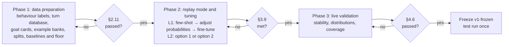

| Phase | Content |
|---|---|
| 1 Data preparation | Behaviour labels, turn database, hidden-state goal cards, example banks and (if needed) training data, splits, baselines and noise floor |
| 2 Replay mode and simulator tuning | Compare decision point by decision point on real agent turns; L1 escalates few-shot → adjust probabilities → fine-tune; L2 chooses between two options (length distribution + few-shot + persona, or LoRA fine-tuning) |
| 3 Live validation | Run the simulator against real agents in the SWE-Together environment, validate stability, distributions, and coverage, then freeze and run the final evaluation |

### Data Roles and Splits

| Data | Use | Mode |
|---|---|---|
| SWE-chat (about 6,000 real sessions, still growing) | Example banks and calibration data; fine-tuning if needed; Axis B | replay (teacher-forced) |
| SWE-Together (109 tasks, with Docker environments) | Axis A and live validation | replay + live |
| The 48 overlapping tasks | Have both an environment and the full original session; main data for Axis A; **never used for training or for tuning decisions** (usage in §2.7) | replay + live |

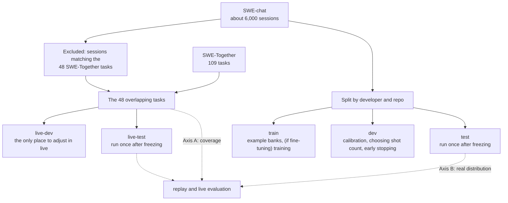

### Core Design Decisions

| Decision | Content |
|---|---|
| Turn-based | Consult the simulator once after each agent turn; the interface is event-based so interruption can be added later (path in §1.8) |
| Separate action and language | **L1 (d3)** decides the behaviour and outputs probabilities; **L2 (local chat model)** writes the message from the action and the "facts allowed to be disclosed" |
| Local-first, progressive tuning | L1 escalates few-shot → adjust probabilities → fine-tune, moving up only if the previous stage is ineffective; L2 keeps two options pending a decision; APIs are reference only |
| Observation and tool permissions | Default is passive observation matching SWE-Together (SWT profile); read-only inspect only in live and in stages; no modification; the simulator has no direct environment access |
| Discriminator | An independent evaluation discriminator is mandatory; a training discriminator is added only for the L2 option-2 extension or for re-ranking; model selection in §3.5 |
| Conditioning on agent turn type | No per-agent models; stratify by "what the agent did this turn" so the approach transfers to new agents |
| Strict dev/test separation | All tuning uses train/dev only; test is run once after freezing |
| Time computed in two parts | The agent's turn duration is taken directly from timestamps (the actual run time in live); the simulator side's time is estimated as a pure function of events, and the simulator's wall-clock is not used |

**Out of scope**: human pilot calibration of review decisions and active time (the retrieval and review parts of A and E, and the evidence sensitivity of R). SWE-chat has no matching observations for these; they are listed as follow-up work (see §6).

---

## 1. Architecture (Iterable)

### 1.1 Components

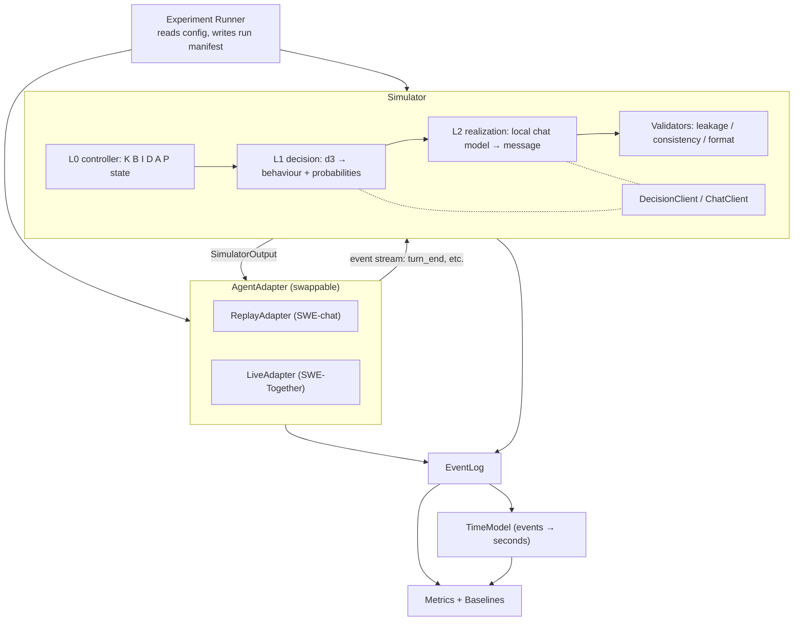

**Tuning side (offline)**

| Target | What is tuned |
|---|---|
| L1 | few-shot example bank → probability adjustment → fine-tuning (escalate only if the previous stage is ineffective) |
| L2 | Option 1 length distribution + few-shot + persona / Option 2 LoRA fine-tuning (optional: discriminator adversarial extension) |
| Independent evaluation discriminator | Used only for evaluation, never for tuning |

### 1.2 Interface Contracts

**Checkpoint** (shared by replay and live)

```json
{
  "checkpoint_id": "sess123#t17",
  "session_id": "sess123", "repo_id": "r9", "user_id": "u4", "agent": "Claude Code",
  "goal_card": {"objective": "...", "constraints": ["..."], "private_facts": [{"id": "F2", "holder": "privately_retrievable"}], "intervention_conditions": ["..."]},
  "prefix": "<conversation and tool trajectory up to this point, summarized and truncated>",
  "visibility_profile": "SWT",
  "agent_turn_type": "asks_question",
  "agent_turn_features": {"ends_with_question": true, "wrote_files": false, "test_failed": false, "diff_chars": 0},
  "real_action": {"behaviour": "correction", "message": "..."},
  "timing": {"user_latency_s": 41.0, "first_write_seen": false},
  "split": "train"
}
```

**SimulatorOutput** (one per checkpoint)

```json
{
  "action": "message",
  "action_probs": {"no_op": 0.10, "non_pushback": 0.20, "correction": 0.60, "failure_report": 0.08, "rejection": 0.02},
  "facts_disclosed": ["F2"],
  "behaviour": "correction",
  "message": "Use UTC, it's in deploy.yaml.",
  "effort_inputs": {"msg_chars": 28, "artifacts_opened": [], "retrieval": false},
  "rationale": "For audit only; not passed to the agent"
}
```

**Event types** (v1 enables only `turn_end`; the rest are reserved)

| Event | Produced by | Status | Description |
|---|---|---|---|
| `turn_end` | agent / environment | enabled in v1 | The agent's turn ends |
| `write_attempt` | agent / environment | reserved | Before the agent writes (whether opencode provides a hook is to be confirmed) |
| `plan_submitted` | agent / environment | reserved | Blocking point: the agent stops and waits, so no true interruption is needed |
| `permission_request` | agent / environment | reserved | Blocking point: same as above |
| `inspect` | a simulator action | v1.5, live only | Log of read-only inspect (see §1.4) |
| `user_interrupt` | a simulator action | v2 | Needs mid-turn cancellation (see §1.8) |

Events come from two sources. Events produced by the agent or environment are the triggers for "when to consult the simulator", and the config chooses which of them consult it with `consult_on: [turn_end]`; the simulator's own actions (`inspect`, `user_interrupt`) are recorded as events for logging and replay. The actions the simulator can actually choose are the action set (§2.2; in live they correspond to SWE-Together's five decision tools). `tool_boundary` in §1.8 is likewise an agent- or environment-produced event. The simulator's reply to a blocking point (`plan_submitted`, `permission_request`) is an existing action (`approve`, `deny`, `redirect`), so no new event type is added; the trigger is recorded in the checkpoint's `event_type`.

### 1.3 Simulator Layers

| Layer | Implementation | Job |
|---|---|---|
| L0 | Rules and state controller | Action eligibility masks, disclosure rules, authority scope, attention budget, time accumulation |
| **L1** | **d3 decision model** (vLLM Semantic Router Decision 3.0) | Answers typed questions and returns a probability for every option: the behaviour label and whether each fact is disclosed now. Tuning escalates few-shot → adjust probabilities → fine-tune (§3.4) |
| **L2** | **Local chat model** | Writes the message from the L1 result and the facts allowed to be disclosed. Two options pending a decision: 1. length distribution + few-shot + persona; 2. LoRA fine-tuning (§3.5) |
| L3 (comparison) | A single local chat model generating end to end | Tests whether splitting into L1 + L2 actually helps |

**Processing flow for one checkpoint**

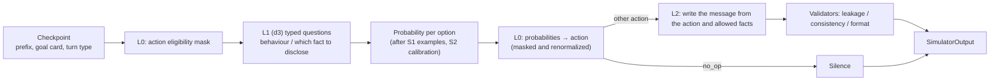

**Why d3 for L1**

| d3 property | Benefit for L1 |
|---|---|
| It does not generate text; it answers choice, yes/no, and score questions and returns a probability for every option | The probabilities become `action_probs` directly, with no sampling-based estimation or JSON parsing |
| Sizes range from 0.6B to 27B under Apache-2.0; each question needs only one forward pass | Low cost |
| Can be self-hosted on vLLM, and a hosted Decision API (`POST /v1/systemone`) also exists | Both local and API paths are available |

**d3 verification results (2026-11-21, from the model card and recipe page; not yet tested on our hardware)**　✓ confirmed　△ unconfirmed

| Item | Status | Content |
|---|---|---|
| Interface | ✓ | `POST /v1/systemone`; question types `choice`, `noul` (yes/no), `score`; at most 64 questions per request and 255 options per `choice`; returns per-option probabilities; the prompt is fixed and a top-level `instructions` field is not accepted |
| Context and cost | ✓ | `--max-model-len 32768` recommended; prefix caching and chunked prefill are off, so cost grows with "number of questions × prompt length" |
| License, sizes, memory | ✓ | Apache-2.0; 27B, flash 9B, mini 4B, nano 2B, lite 0.8B, edge 0.6B; 27B peak about 62–65 GiB (details in Appendix D) |
| vLLM | ✓ (not installed and tested) | Supported from 0.33.0 (go by the recipe page and PyPI; the model card's "needs nightly" is outdated) |
| NVIDIA path | △ | Officially tested only on AMD MI300X/MI325X; the CUDA path is unverified; this is the first risk to verify (§3.1 gate F) |
| few-shot | △ | The docs do not mention putting examples in state; needs testing |
| Fine-tuning | △ | No training code or readout description; self fine-tuning is high-risk; S3 defaults to "local chat-model LoRA as L1", with d3 fine-tuning as a high-risk option |
| Small-size performance | △ | d3-lite and edge performance on this task is unknown |

### 1.4 Observation and Tool Permissions (Visibility Profile)

Should the simulator be able to actively query the agent's actions or modify files? The default answer is: **no modification and no direct environment access; decide the next step only from the agent's reply and a restricted activity summary.** Query ability is added in stages as "costed read-only inspect".

| Tier | Capability | Timing | Rationale |
|---|---|---|---|
| T0 Passive observation (default) | The agent's reply plus an activity summary provided according to the visibility profile | v1 | Replay and live inputs match, so results are comparable with real users |
| T1 Read-only inspect | Choose to open items from a controller-provided artifact list (diff hunks, test output, files); each open is logged as an `inspect` event and consumes E and A | live only, v1.5 | Maps to A, R, and RQ3's "evidence-limited maintainer" |
| T2 Run checks | Run predefined reproduction or test commands | Later | Changes environment state and costs time; similar to SWE-Together's check-external action |
| Not planned | Modifying files (co-editing) | Later extension | See rule 7 below |

**Information flow and boundaries**

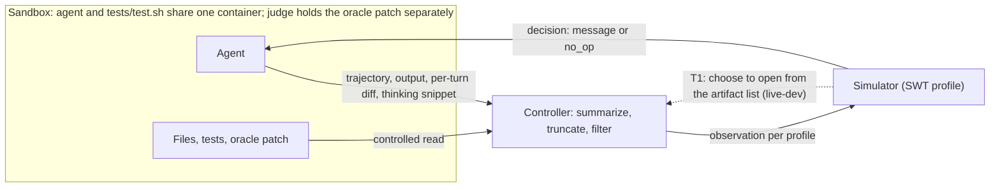

There is no direct connection between the simulator and `FS`: this is rule 5 drawn out.

**Visibility profile**

The default is **SWT**, i.e. what the SWE-Together simulator sees; P0–P3 are kept for later ablation. P0 ⊂ P1 ⊂ P2 ⊂ P3, adding information at each level.

| Profile | What the simulator sees |
|---|---|
| **SWT (default)** | See the table below |
| P0 | Only the agent's reply text |
| P1 | P0 + activity summary (tool names, files touched, commands run, errors) |
| P2 | P1 + diff summary (files and lines added/removed) |
| P3 | P2 + full diff (with a truncation cap) |

**SWT contents (per `UserAgent.process()` and `_build_turn_summary`)**

| Item | SWE-Together's approach | Our replay equivalent |
|---|---|---|
| Task description | Provided only on the first call, truncated at 16,000 characters | The first user prompt in SWE-chat (or the objective in the goal card) |
| Time | Elapsed seconds and this turn's duration (real wall-clock) | **Difference**: the agent's turn duration comes from timestamps; the simulator side's time (typing, answering, etc.) is estimated from events by the time model, not from the simulator's wall-clock |
| Completion flag | `is_completion_attempt`: adds a line when the agent signals completion | Inferred from turn features; the definition must be aligned with live |
| Agent activity | `recent_trajectory`, not truncated in the function | Reconstructed from `tool_use` / `tool_result` |
| Agent output | `latest_observation`, not truncated in the function | The agent's last reply text |
| Code changes | `code_changes_diff`: a per-turn delta produced by the caller `UserEnabledClaudeCode._capture_git_diff`; the sandbox doc states a 200k-character per-turn diff cap | Approximately reconstructed from Edit/Write tool inputs and file snapshots |
| Agent thinking | `latest_analysis`, truncated at 300 characters | SWE-chat `assistant_thinking` rows, truncated at 300 characters |
| History | Prior turns' user messages and the simulator's own decisions (with reasoning) | Replay uses what the real user actually said (teacher-forced); live uses the simulator's own decisions |
| Hidden information | System prompt contains the persona and an optional `session_analysis` | Hidden-state goal card |
| Output | Five decision tools (no-op, question, redirect, new_requirement, check_external); `tool_choice` is required or auto; retries once if no tool call is returned | Structured output; typed questions when L1 uses d3 |
| Stopping | A hard `max_messages` cap; after it is reached every turn becomes a no-op | Same |
| Environment access | None; none of the five decision tools can read files, run commands, or inspect the repo; file contents, test results, and command output reach the simulator only if they appear in the trajectory, observation, or diff | Same |

**One deliberate difference from SWE-Together**: the time source (agent turns use timestamps, the simulator side is estimated from events, and the simulator's wall-clock is not used). All other inputs, including the agent-thinking snippet, match SWE-Together.

**Rules**

| # | Rule | Explanation |
|---|---|---|
| 1 | Replay and live use the same profile | Otherwise results from the two modes are not comparable |
| 2 | **Agent-thinking snippet** | Fully matches SWE-Together: provided and truncated at 300 characters, **no ablation** (replay uses SWE-chat `assistant_thinking` rows). Limitation: it is uncertain whether real users' interfaces display it (what users actually saw cannot be confirmed), and conclusions note this |
| 3 | The profile is a design assumption | SWE-chat does not record what real users actually looked at. No ablation for now; we stay consistent with SWE-Together to ease reproduction and comparison |
| 4 | Replay diffs and the completion flag are approximate | They must be reconstructed from tool inputs, file snapshots, and turn features, which is imprecise. Whether the diff is incremental or cumulative must be defined explicitly (SWE-Together's code comment says per-turn delta, while the sandbox doc says the diff is taken against the `harbor-base` tag; the two may mean different things) |
| 5 | **Do not give the simulator environment access** | In SWE-Together's sandbox, the task's `tests/test.sh` runs in the same container as the agent, and the judge separately holds the oracle patch. A simulator that could query the environment freely might read hidden tests or the reference patch. The T1 artifact list is filtered by the controller |
| 6 | **Inspect cannot be validated on SWE-chat** | There are no records of real-user inspection; in replay, inspect can only be answered from the recorded trajectory. T1 realism can only be validated in the pilot (RQ3) |
| 7 | **Why no modification** | Real users do edit code themselves (SWE-chat's sessions table has `human_added` and `human_modified` fields), so this is worth doing later; but v1 excludes it: SWE-Together excluded sessions where humans wrote most of the final change when building tasks, and its grading assumes the agent produces the change. If the simulator could edit files, the task would become co-editing and would need a new task split and grading |
| 8 | **Inspect is "choose from a list", not free-form querying** | The controller lists the available artifacts with their time costs and the simulator decides which to open. This fits the limited-attention setting and keeps behavior loggable and replayable |

### 1.5 Models and Backends

| Role | Default | Notes |
|---|---|---|
| L1 | d3 family (lite 0.8B, nano 2B, mini 4B, flash 9B, d3 27B) | Via DecisionClient; pinned revision; tuning follows the ladder in §3.4 |
| L2 | Local chat models (about 7–8B and about 30B, one of each) | Via ChatClient (LiteLLM pointing at a vLLM or other OpenAI-compatible server); Option 1 prompt-based, Option 2 LoRA (pending decision) |
| Evaluation discriminator | A separate architecture, trained only after the generator is frozen | **Mandatory**; used only for evaluation; model selection in §3.5 |
| Training / re-ranking discriminator | Small encoder or small LM with a binary classification head | **Optional**: used only for L2 option 2b, or for best-of-n re-ranking in option 1; separate in architecture and data from the evaluation discriminator |
| Matcher, judge | One fixed strong model (may be an API), from a model family different from L2 and d3, version pinned | Validated against human labels separately on real and simulated messages; a subset is re-judged by a model from another family, and any change in main conclusions is noted; the simulator itself does not depend on it |
| API models | Reference baselines only | E.g. a chat-model L1, an API L2 |

| Practical setting | Approach |
|---|---|
| Fine-tuning framework | LoRA / QLoRA (e.g. PEFT, TRL), used only when escalating to fine-tuning |
| d3 serving | vLLM 0.33.0 or later, recommended `--max-model-len 32768`; when several services share a GPU, lower `--gpu-memory-utilization` (default reservation is 92%); see Appendix D for memory estimates |
| Caching | All calls are cached keyed by "model, version or revision, prompt hash, seed" |
| Backend metrics | Parse-failure rate, token counts, and inference latency are all logged as metrics (latency is for reference only and does not enter the time model) |

### 1.6 Iteration Mechanics

| Mechanism | Approach |
|---|---|
| Run manifest | Every experiment and every training run writes a manifest recording the data split version, simulator config, model revision, LoRA weights, discriminator version, prompt version, seed, and code commit |
| Model and calibration artifacts stored separately | One per backbone and per training round, never carried across models |
| Change one knob at a time | Record the change and the before/after metric difference in `CHANGELOG.md` |
| Test guard | Access to the test split requires the `--final` flag and every access is logged; the post-freeze test evaluation is run only once |
| Freeze tags | `v1-candidate`, `v1-frozen`; after freezing, the simulator, discriminators and scoring rules do not change |

### 1.7 Suggested Directory Layout

```
simulator/
  configs/   data/{raw,processed,splits}/   docs/   runs/   CHANGELOG.md
  models/    # example-bank indexes, length and style statistics, calibration artifacts, (if any) LoRA weights (versioned)
  src/{llm, schemas, data, sim, stages, disc, adapters, eval}/
```

### 1.8 Extension Path for Mid-Turn Interruption

**Can the current turn-based design support it?** At the interface level yes, at the behavior level no: events, config, and checkpoint fields are already reserved, so the architecture does not change; but the simulator is consulted only at `turn_end`, and there is no consultation point while the agent is mid-work, so new consultation points are needed for true interruption.

| Capability | Current turn-based (consulted only at `turn_end`) | What must be added |
|---|---|---|
| Blocking-point events (plan submission, permission requests) | ✓ Yes: the agent stops and waits by itself, and the simulator is consulted at that event | Event hooks (whether opencode provides them is to be confirmed) |
| Queued interjection: typed while the agent works, delivered once the current tool calls finish | ✗ No: there is no consultation point while the agent works | Intra-turn consultation points (tool boundaries), `inject(queue)` |
| Hard interrupt: cancel the current action and redirect | ✗ No | Harness cancel and resume, `cancel()`, an event time axis |

**How real clients behave (design basis; behavior varies by client and version and must be confirmed in the data and the harness)**: in Claude Code, a message typed while the agent works is queued by default and delivered in the same turn once the running tool calls finish; Esc is a hard interrupt that keeps completed work. Other versions, such as the desktop app, behave differently (sources in Appendix C). SWE-chat's `queue_operation` records queued messages (`user_prompt_enqueued`, `user_prompt_delivered`, `user_prompt_discarded`) and is the baseline for queued interjection; hard interrupts have no dedicated field, and their recorded form must be confirmed in the raw transcripts.

**Flow when an interruption happens**

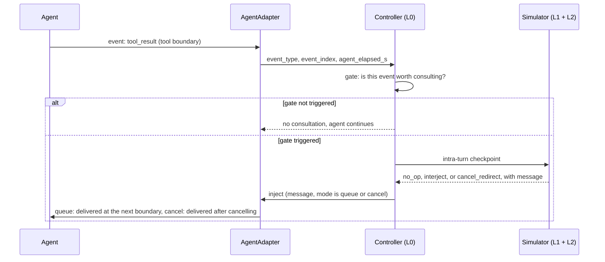

**Roadmap**

| Stage | Capability | Consultation point | Required changes | How it is validated |
|---|---|---|---|---|
| v1 (current) | Respond at turn end | `turn_end` | — | Phases 2 and 3 |
| v1.5 (alongside T1, optional) | Blocking-point events, read-only inspect | `plan_submitted`, `permission_request`; inspect (live) | Event hooks; artifact list | Pilot (SWE-chat has no matching data) |
| v2a | Queued interjection | Tool boundaries, through the gate | Intra-turn checkpoints; `inject(queue)`; add `interject` to the action set | replay: calibrate with `queue_operation`; live: effect |
| v2b | Hard interrupt | Tool boundaries, through the gate | Harness cancel and resume; `cancel()`; add `cancel_redirect` to the action set | live-dev; confirm whether the agent's completed work is preserved |

**Reservations to make now**

| # | Reservation | Reason |
|---|---|---|
| 1 | Add `event_type`, `event_index`, `agent_elapsed_s` to the checkpoint (fixed to `turn_end` in v1) | Intra-turn checkpoints need no schema change |
| 2 | Reserve `interject` and `cancel_redirect` in the action set (turned off in v1 by the eligibility mask) | No change to the structure of L1's questions |
| 3 | Reserve `events()`, `respond(event, decision)` (reply to a blocking point), `inject(message, mode)`, `cancel()` in the AgentAdapter interface (v1 implements turn end only) | Replay and live share one interface |
| 4 | Reserve `consult_on: [turn_end, tool_boundary]` and `gate` in the config | Consultation points and the gate are set by configuration |
| 5 | Treat the time model as an event clock: the simulator decides at event time t (taken from the agent's timestamps), the time model supplies typing time, and the message is delivered at the first boundary after t plus typing time; if the agent's turn ends first, it degrades to an ordinary turn message | Matches queue semantics and does not use the simulator's wall-clock |
| 6 | Extract the `queue_operation` baseline already in Phase 1 (already in §2.3) | Learn how often and when real users interject |

**Cost control and evaluation**: more consultation points multiply d3's compute (the formula in Appendix D), so a gate first decides "is this event worth consulting" and the full L1 runs only when it fires; the gate can be L0 rules (errors, test failures, repeated edits, long silence, first write, diff above a threshold) or a single `noul` question to d3-lite. Evaluation looks at intervention rate and timing (stratified by agent activity type), boundary-level AUPRC and calibration, and the share of queued vs hard interrupts; live-dev also looks at the effect on agent outcomes and the over-interruption rate.

**Limitations and risks**: in teacher-forced replay the trajectory already diverges after a real user's interruption, so replay can only use the real trajectory and has no counterfactuals; SWE-chat's record of hard interrupts may be incomplete; queue semantics differ across agents and clients; whether the harness can inject messages and cancel the agent is unverified (§6).

---

## 2. Phase 1: Data Preparation

### 2.1 Obtaining the Data

| Data | Source | Access and license | Use |
|---|---|---|---|
| SWE-chat | Hugging Face `SALT-NLP/SWE-chat` | Requires login and acceptance of access conditions; license odc-by | Use the `conversations`, `sessions`, and `session_logs` tables; when full content is needed, read the raw jsonl that `transcript_path` points to (tool results in the conversations table are truncated at 10KB); pin and record the downloaded version (the dataset keeps growing) |
| SWE-Together | Hugging Face `yfwu/SWE-Together` (109 tasks) and the GitHub repo | Code is Apache-2.0 | First reproduce its pipeline on 3–5 tasks to confirm the simulator interface, the user-sim prompt, and the scoring scripts |

### 2.2 Behaviour Labels (v1)

v1 has **no tagger and no K/D/I/C coding** (moved to §6 Follow-Up Extensions). Stage 2 and 3 compare **behaviour distributions** only.

| Item | Content |
|---|---|
| Label set | `no_op`, `non_pushback`, `correction`, `failure_report`, `rejection` |
| Source for real users | `no_op` is mechanical (no user message); the other four are SWE-chat's own `prompt_pushback` labels |
| Unlabeled messages | Rows without a dataset label are marked `unlabeled`, reported separately, never guessed |
| Source for the simulator | L1 chooses the label directly (`action_probs` is over this set) |
| Cleaning | Harness-written rows (interrupt markers, slash commands, image-only rows, automated review sessions) are not user behaviour and are removed |
| Known limits | The dataset labels are LLM-produced and not verified by us. The simulator's label is self-declared: nothing checks that its message matches it. No annotator agreement is measured |

### 2.3 Building the Turn Database

| Item | Content |
|---|---|
| Checkpoint definition | One checkpoint after each agent turn; the real action is "the next user message" or "silence (no_op)". **Silent checkpoints must be included**, otherwise the simulator's tendency to talk too much cannot be measured |
| Turn boundaries | Derived from the `user_prompt`, `assistant_response`, `tool_use`, and `tool_result` rows of the `conversations` table |
| `queue_operation` | Recorded separately (messages typed while the agent is busy) as a baseline for future interruption behavior (§1.8) |
| Recorded per checkpoint | Prefix (summarized and truncated), agent turn type and features, real action and behaviour label, user latency, and whether a first write has appeared |
| The prefix must not see the future | This is the first line of defense in leakage checks |

### 2.4 Hidden-State Goal Cards — Needed for Few-Shot Examples and Fine-Tuning

On a new task the simulator must act according to "what the user knows and wants", so examples and training data need the same input. SWE-chat has no such annotation, so a card must be built for each session.

| Item | Content |
|---|---|
| Card content | Objective, constraints, facts the user privately knows (with holder and retrieval path), and intervention conditions |
| How it is produced | Reconstructed from the whole session by a **local model** (endpoint and model set in `.env`) (following SWE-Together's session analysis), **forbidding verbatim copying of later user messages** |
| Leakage audit | Compare n-gram overlap between the card and later messages, with manual spot checks |
| Known risk | The card is produced with hindsight, so the model may learn a "follow the card" shortcut; training-time cards (LLM-reconstructed) differ in distribution from test-time cards (authored fixtures, SWE-Together's session analysis) |
| Mitigation | Run an ablation with a card vs. history only; state that Axis B conclusions were obtained under the card condition |
| The 48 SWE-Together tasks | Use their existing session analysis directly; do not rebuild |
| Alignment with SWE-Together | SWE-chat cards are rebuilt with the same fields and generation method as the session analysis (if its prompt and format are not public, design from its output fields and align as closely as possible) to narrow the train/test card distribution gap; alignment is checked only through field-level statistics (length, number of facts), without using the 48 overlapping tasks to tune the prompt (§2.7) |

### 2.5 Example Banks and Training Data

| Purpose | Content | Source and notes |
|---|---|---|
| L1 few-shot example bank (S1) | Real checkpoints: state, real action, behaviour label | From **train**; retrieved by agent turn type and state similarity; labels are the dataset's and are noisy |
| L1 calibration set (S2) | Same, used to fit temperature, per-class bias, and the stacked calibrator | From **dev**, disjoint from the example bank |
| L1 fine-tuning data (S3, only when escalated) | state + typed questions → real labels | From train; no_op is over-represented, so weight or balance sampling; training uses dataset labels, while dev/test evaluation labels come from a human-verified subset |
| L2 length and style statistics (option 1) | Message length distribution (conditioned on action and agent turn type), style features | From train; only non-no_op checkpoints |
| L2 few-shot example bank (option 1) | Real messages with state and action | From train; retrieved by action, agent turn type, and similarity; grouped by persona |
| Persona labels (option 1) | SWE-chat `user_persona` (Expert Nitpicker, Vague Requester, Mind Changer, Other) | LLM-annotated; reliability needs spot checks |
| L2 LoRA data (option 2, if adopted) | state + real action + facts allowed to be disclosed → real message | From train; remove system-injected text, interruption markers, and similar residue; deduplicate |
| Discriminator data | (state, action, message) → real or generated | Mandatory for evaluation, optional for training/re-ranking; negatives are generated by L2 under the same state and real action |

Data handling notes: user messages may contain names, paths, keys, and other sensitive content. The example bank puts real messages into prompts, and fine-tuned models carry memorization risk; both require anonymization and deduplication, and the license (odc-by) and permitted use must be recorded.

### 2.6 Agent Turn Types (Stratification)

A small set of types determined mechanically from tool calls and responses, used to remove the effect of agent mix when comparing.

| Item | Content |
|---|---|
| Example types | Ends with a question, claims completion, reports an error or is blocked, submits a plan, large edit, ordinary progress |
| Check | The sample size of each type; merge types with too few samples |
| Mark | Types with "no calibration data" |

### 2.7 Splits

| Item | Rule |
|---|---|
| Unit of splitting | Split train/dev/test by **developer and repo**; the same developer or repo never spans splits |
| Use of each split | train: example banks and (if fine-tuning) training; dev: calibration, choosing the number of shots, and early stopping; test: run only once after freezing |
| Exclusion | The sessions corresponding to the 48 SWE-Together tasks that come from SWE-chat are in none of train, dev, or test and are used only for Axis A |
| Use of the 48 overlapping tasks | Not used for any tuning (example banks, calibration, fine-tuning, option decisions, early stopping). Per the live-dev / live-test split in §4.2 (replay and live share the same split): in Phase 2 only monitor Axis A metrics on live-dev and make no selections from them; run live-test once after freezing; limits on live-phase adjustment are in §4.4 |
| leave-one-agent-out | Prepare the folds in advance (first count sessions per agent). Example banks and calibration can be rebuilt per fold cheaply; if escalating to fine-tuning, every fold needs retraining, so the first version does it for L1 only |
| Freezing | Splits are frozen and versioned at the end of Phase 1 |

### 2.8 SWE-Together Task Mapping

| Item | Content |
|---|---|
| Mapping table | Build a mapping between the 48 tasks and SWE-chat sessions (confirm which session identifiers the tasks retain) |
| Gold | For each task, split the original user messages into **atomic intents** and annotate action type, trigger condition, and position; these serve as the gold for Axis A |
| Not included | Tasks from other sources (DataClaw, Pi-staging, Hyperswitch) have different formats and are not included in the first version |

### 2.9 Baselines and Noise Floor

| Item | Content |
|---|---|
| Baselines | Always no_op, empirical-frequency sampling (by agent turn type), a persona-only LLM, d3 zero-shot, and a prompt-based local chat model |
| **Real-vs-real floor (distribution)** | Split the real data in half by developer and compute the distribution gap between the halves |
| **Real-vs-real floor (discriminator)** | Train a discriminator to tell apart "real messages from different developers"; its accuracy is the reference lower bound for discriminator evaluation |

### 2.10 Time Model v0

| Item | Content |
|---|---|
| Agent turn duration | Taken directly from SWE-chat timestamps (the actual run time in live), not estimated |
| Form | A pure function from events to seconds, used only on the simulator side |
| Simulator-side answering and typing times | Calibrated from real user latency, using medians and trimming (latency includes idle time) |
| Retrieving evidence, reviewing patches | Cannot be observed in transcripts; leave blank for now until pilot calibration |

### 2.11 Deliverables and Pass Criteria

| Deliverable | Pass criteria (numeric thresholds set in advance) |
|---|---|
| Behaviour labels | Harness-written rows removed; label coverage and unlabeled share reported |
| Turn database and splits | No developer or repo leakage; the 48 overlapping tasks excluded; sample sizes per agent turn type inventoried |
| Hidden-state goal cards | Leakage audit passed; spot checks acceptable |
| Example banks and training data | Label quality quantified; cleaning and anonymization done; example bank comes only from train |
| SWE-Together task mapping and gold | Mapping table complete; atomic intents spot-checked |
| Baselines and floor | Baselines and the real-vs-real floor computed |
| Reproduction check | 3–5 tasks run through the original pipeline |

---

## 3. Phase 2: Replay Mode and Simulator Tuning

### 3.1 Starting Point and Gates

See §1.3 for the d3 verification results.

| Gate | Question | Approach and status | What the result decides |
|---|---|---|---|
| **Baseline (S0)** | Where do we start | d3 zero-shot at each size for L1; a prompt-based local chat model for L2 (no length distribution, few-shot, or persona). Compare on dev together with the §2.9 baselines | The reference for every later stage |
| **A** | Can d3 make effective use of few-shot examples | The official docs do not mention putting examples in the state; needs testing | If there is no measurable effect, L1 goes straight to S2 |
| **B** | Is the context length enough | Confirmed usable (32,768 recommended). Latency and memory at 32k still need testing, and prompts should be summarized to stay short, because prefix caching is off and every question recomputes the whole prompt | Prompt summarization strategy |
| **C** | Can d3 be fine-tuned | The docs provide no training code or procedure; fine-tuning d3 requires our own implementation, and its readout mechanism is undocumented, so it is a high-risk option | S3 defaults to "LoRA fine-tune a local chat model as L1" |
| **D** | Which L2 option | See the decision gate in §3.5 | The L2 route |
| **E** | Whether to ablate visibility | **Postponed**; fixed at SWT for now | — |
| **F** | Does d3 work on NVIDIA | The official tests ran on AMD MI300X/MI325X, and the docs state the CUDA path has not been run on NVIDIA. On A100 and H200 with vLLM 0.33.0 or later, test each d3 size: whether it starts, whether results match AutoModel (officially 415 of 416 questions matched on MI300X, a useful reference), latency, and memory | Whether d3 can be used on our GPUs |

### 3.2 Teacher-Forced Evaluation Protocol

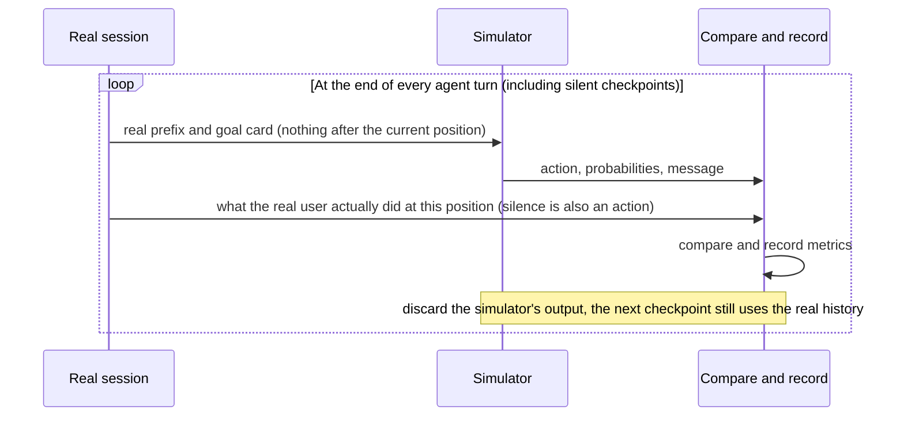

The simulator's memory holds what the real user actually said. Interpret the result as an **upper bound** on single-step realism; do not use it to predict live performance.

### 3.3 Metrics

| Layer / axis | Metrics | Approach and comparison |
|---|---|---|
| Action layer (L1) | log loss, Brier score, macro-F1 and per-class accuracy, calibration error (ECE), forward/backward KL within each agent turn type | Compared with the baselines |
| Distribution comparison (Axis B) | Behaviour distributions within each agent turn type; JS or TV distance | Computed for real users and the simulator separately, aggregated with fixed weights (e.g. the proportions of each type in the test set) to remove the effect of agent mix; developer-level bootstrap confidence intervals |
| Distribution comparison (Axis B) | Per-session or per-developer rate distributions (including dispersion) | Compared in addition to the pooled distribution |
| Conditional behavior | For example P(correction ｜ agent claims completion); P(message ｜ before first write) | Real vs. simulator |
| Language layer (L2): discriminator | **Evaluation-discriminator accuracy and AUC** (see §3.5) | Compared with the real-vs-real (different developers) floor |
| Language layer (L2): consistency | Deferred: needs the tagger (§6) | — |
| Language layer (L2): leakage rate | — | — |
| Language layer (L2): style distribution | Message length, share of terse transactional messages, pleasantries, path and code references, share of questions | Compared with the real distribution |
| Language layer (L2): diversity | distinct-n, variation across repeated samples for the same context, dispersion of the length distribution | Prevents mode collapse |
| Language layer (L2): human / LLM judgments | Realism judgments | Occasional audits only (SWE-Together's Turing pass rate was only 46%, so it is unsuitable as the main evidence) |
| Single-task coverage (Axis A, 48 tasks) | Intent recall/precision | Is each gold intent expressed by the simulator at the corresponding position (allowing a small position window); how many non-no_op messages fall within some gold intent |
| Single-task coverage (Axis A) | Action-type recall/precision; timing alignment | — |
| Single-task coverage (Axis A) | Matching method | A fixed strong model, validated by spot-checking against human labels |

The language layer (L2) is evaluated on its own with the **real action as input (oracle action)**. Formulas, smoothing, and confidence-interval procedures for Intent Coverage and the distribution gap are in Appendix E. Axis A numbers are only monitored in Phase 2 and no selections are made from them (§2.7).

### 3.4 L1 Progressive Tuning

| Stage | What to do | Data |
|---|---|---|
| S0 Zero-shot | d3 answers the typed questions directly (baseline) | — |
| S1 Few-shot | Put retrieved real examples into the state | Example bank (train) |
| S2 Adjust probabilities | Post-hoc calibration: learn temperature and per-class bias by agent turn type; re-weight priors against empirical frequencies; if needed, a stacked calibrator (e.g. logistic regression) combining d3's option probabilities with agent-turn-type features | Calibration set (dev) |
| S3 Fine-tune | Fine-tune d3 on real labels (if feasible), otherwise LoRA fine-tune a local chat model as L1 | Fine-tuning data (train), early stopping on dev |

**Escalation rules (to be confirmed)**

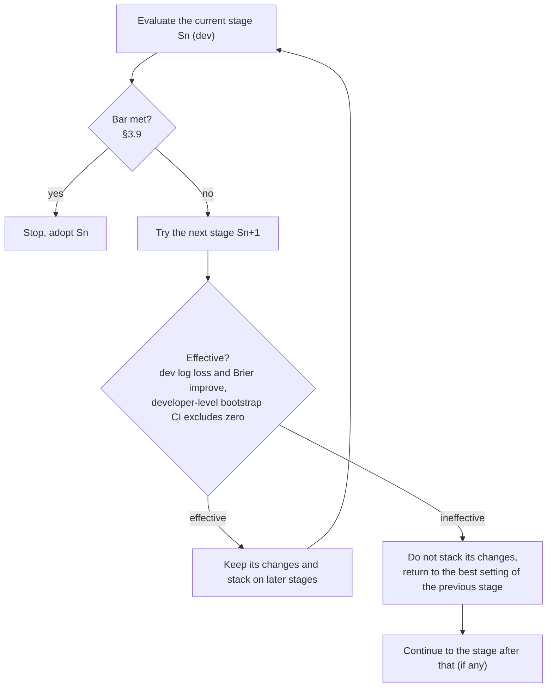

Every stage is reported with the same metrics, forming a ladder table that doubles as the ablation.

**Stage details**

| Stage | Details |
|---|---|
| S1 | Example selection: same agent turn type and similar state; the number of shots k is chosen on dev, bounded by d3's context length. Class mix of the examples: try both natural frequency (preserves the prior; no_op dominates) and class-balanced; balanced sampling pushes predictions away from the true prior and needs S2 to correct it afterwards |
| S2 | Fit separately per agent turn type; merge types with few samples or mark them "no calibration data". Calibration parameters belong to each backbone and size and are not carried across models. The action eligibility mask (L0) is applied to the output probabilities, which are then renormalized |
| S3 | Hierarchical questions: ask the behaviour first; ask "which fact to disclose" only when the behaviour makes it relevant. Cross-entropy loss; class weighting or balanced sampling for the no_op excess; stratified sampling by agent turn type; early stopping on dev. Estimate the effect of label noise using the human-verified subset |
| Size | Start from d3-mini and compare upward or downward to find the "smallest sufficient size" |

### 3.5 L2: Two Options (Pending Decision)

**Goal**: given that the action and facts have already been decided by L1/L0, make the generated message linguistically close to a real user without violating constraints.

#### Option 1: Length Distribution + Few-Shot + Persona (No Weight Updates)

| Component | Approach |
|---|---|
| Length | Estimate from train the message-length distribution conditioned on "action × agent turn type"; before each generation, draw a target length and put it in the prompt or use it as a cap. At evaluation, compare the generated and real length distributions (e.g. KS distance) |
| Few-shot | Retrieve real messages (from train) with the same action, same agent turn type, and similar state |
| Persona | Group by `user_persona` and use that persona's own examples and length distribution. In population-matched mode, draw the persona from the empirical distribution; in controlled mode, fix it. Persona is a session-level label produced by an LLM, so its reliability must be spot-checked first |
| Optional: re-ranking | Sample n candidates and re-rank them with a cheap style and consistency scorer. If a discriminator is used for re-ranking, it must be separate from the evaluation discriminator |

#### Option 2: LoRA Fine-Tuning (Pending Decision on Adoption)

| Sub-option | Content |
|---|---|
| **2a SFT** | LoRA fine-tune "(state, action, allowed facts) → real message"; this also serves as the reference model |
| **2b Adversarial extension (optional)** | Train a discriminator to tell real from generated messages, and use its signal to iteratively update L2 |

**The adversarial loop in 2b**

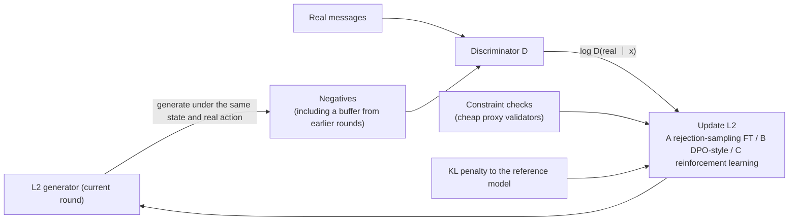

**Discriminator design (2b)**

| Item | Approach |
|---|---|
| Input and output | Input (state, real action, message); output the probability of "real". Negatives are generated by the current L2 under the **same state and the same real action**, so the discriminator learns only language differences |
| Pairwise discriminator (optional) | Given two messages for the same context, decide which one a human wrote; this is more sample-efficient and less affected by length shortcuts |
| Negative buffer | Keep a buffer of negatives generated in earlier rounds, so the discriminator does not overfit to the latest generator and cause oscillation |

**Ways to update L2 (from most to least stable; try in order)**

| Method | How | Characteristics |
|---|---|---|
| A. Rejection-sampling fine-tuning | For each context draw n candidates, keep the one with the highest discriminator score that passes the constraints, and run SFT | Most stable, simple to implement |
| B. Preference-based (DPO-style) | Preference-tune with the real message as chosen and the model's own generation as rejected; similar in spirit to self-play fine-tuning | No online RL needed, still keeps the adversarial idea |
| C. Reinforcement learning | Use the discriminator score as the reward plus a KL penalty to the reference model (PPO / GRPO style) | Possibly the strongest, but unstable and resource-hungry |

Reward form (C, or for ranking in A): `reward = log D(real | x) − β·KL(π ‖ π_ref) − λ·1[constraint violated]`. During training, constraint checks use cheap proxy validators (rule-based leakage checks, small classifiers).

**Safeguards (2b)**

| Risk | Mitigation |
|---|---|
| The generator exploits discriminator loopholes (e.g. deliberate typos, getting shorter) | KL penalty; discriminator ensembles or periodic re-initialization; inspect the length and format distributions of generations |
| The discriminator relies on shortcuts (length, format, data-cleaning residue) | Clean the data; match the length distribution of negatives; run feature ablations; pairwise discriminator |
| Mode collapse | Track diversity metrics; KL penalty; keep the SFT reference every round |
| Circularity: training and evaluating with the same discriminator | The evaluation discriminator uses a different architecture, is trained only after the generator is frozen, is trained on train data, and is evaluated on test |
| The discriminator checks realism, not correctness of information | Constraint checks as hard filters and reward terms; consistency and leakage remain independent pass criteria |
| Accuracy near 50% does not mean truly similar | Cross-check with the independent discriminator, style distributions, and small-scale human audits |
| Discriminator accuracy is hard to push down to 50% (different developers naturally have personal styles) | Use the accuracy between real messages from different developers as the reasonable floor, not 50% |

Adversarial training is itself unstable. The above is a design proposal that has not been validated on this task; the stopping criterion is when the independent discriminator's accuracy and the style distributions on dev stop improving, or when diversity or consistency starts to degrade, with the maximum number of rounds decided by a small pilot run.

#### Discriminator Model Selection

The evaluation discriminator (mandatory) and the training/re-ranking discriminator (optional) are chosen separately; the model names are candidates, the final choice is decided by measurements on dev, and the latest available versions should be confirmed at implementation time.

| Role | Candidate | Why | Limits |
|---|---|---|---|
| Evaluation A (primary) | Fine-tuned encoder: DeBERTa-v3 (base about 184M, large about 400M) | A controlled study (same pretraining data) found DeBERTa-v3 ahead of ModernBERT in overall performance and sample efficiency (retrieval tasks excepted); in another GitHub-repository classification study DeBERTa-v3-base beat ModernBERT-large. Our data is limited, so sample efficiency matters | Limited input length, so the state must be compressed into a short summary; the message itself is usually short |
| Evaluation B | ModernBERT-base (about 139M) | Faster to train and run, with native support for longer context; its pretraining and architecture differ from DeBERTa, giving a cross-check from a different family | Not necessarily as sample-efficient as DeBERTa-v3 on the same data |
| Evaluation C | Surface features and n-grams (TF-IDF) with logistic regression or gradient-boosted trees | Transparent; directly exposes shortcuts (length, punctuation, casing, share of paths and code snippets, whether it is a question); also the baseline for discriminators | Cannot capture semantic-level differences |
| Evaluation D (optional) | LLM with a LoRA classification head (about 1–8B), model family must differ from L2 | Can handle longer state; possibly the strongest detector, giving the tightest bound | Higher cost; the same family as L2 would lose independence |
| Auxiliary | Frozen embedding plus a linear probe | Lightweight, suited to distribution-level diagnostics (see below) | Cannot see style; must not be the sole discriminator |
| Training / re-ranking (optional) | Small encoder (e.g. MiniLM or DistilRoBERTa class, or ModernBERT-base) | Cheap and quick to retrain; a pairwise version can be used for 2b | Must be separate from the evaluation discriminators in architecture, data subset, and seed |

| Usage rule | Explanation |
|---|---|
| Headline number | Use the evaluation discriminator with the highest accuracy (it gives the tightest bound); the others are diagnostics |
| Input variants | Run all three: message text only (tests style), message + action, message + action + compressed state (tests consistency) |
| Training setup | Length-matched negatives; multiple seeds with confidence intervals; compare with the different-developer floor in §2.9 |
| Independence | The evaluation discriminator is trained only after the generator is frozen, trained on train and evaluated on test; no discriminator used for training or re-ranking may reuse the same model |
| How the choice is made | Use "pairs of real messages from different developers" as the benchmark task and compare the candidates on dev; do not decide in advance |

**Role of embedding similarity**: not used as the sole discriminator (it normalizes away human traits such as length, punctuation, and typos); used only for distribution-level comparison (MMD, Fréchet distance), diversity, nearest-neighbor memorization checks, and a lightweight linear probe.

**Off-the-shelf detector baselines**: I found no pretrained discriminator trained specifically on "real vs simulated user messages", so the evaluation discriminator still has to be trained by us. Zero-shot detectors (Binoculars, Fast-DetectGPT) and pretrained supervised detectors can serve as supplementary baselines, but they are unstable on short and out-of-domain text: a high AUC is strong negative evidence, and a low AUC is uninformative. Commercial APIs are not used for privacy reasons; lexical-diversity metrics (MATTR, HD-D, Yule's K) go into the style distribution in §3.3.

#### Decision Gate (Pending)

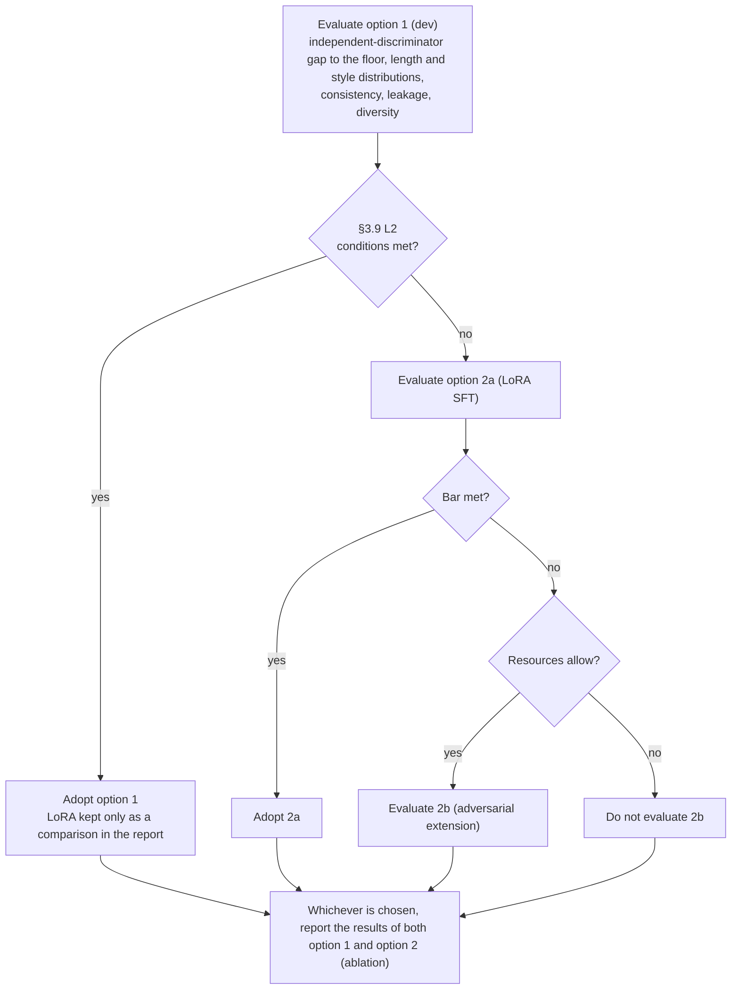

Selection criteria are registered in advance:

| Criterion | Explanation |
|---|---|
| Bar met or not | Whether the §3.9 L2 conditions are met |
| Gap to option 1 | Whether it exceeds noise |
| Cost | Training and inference cost |
| Risk | The privacy and memorization risk that fine-tuning brings |

### 3.6 Diagnostic Flow

Use the dev behaviour distribution, within each agent turn type, to locate which layer is failing:

| Symptom | Most likely layer | What to adjust |
|---|---|---|
| Too much or too little `no_op` | L1 | Calibration by agent turn type; training-data balance |
| Wrong mix of `correction` / `failure_report` / `rejection` | L1 | Calibration for that turn type |
| Right label but unrealistic message | L2 | Length model, example bank, or training data |

### 3.7 Model Comparison Experiments

| Factor | Levels |
|---|---|
| L1 stage | S0 zero-shot / S1 few-shot / S2 adjust probabilities / S3 fine-tune (per the escalation rules; stages not reached are not run) |
| d3 size | lite, nano, mini, flash, 27B (start from mini, compare upward or downward) |
| L1 comparison | Baselines; prompt-based local chat model as L1 |
| L2 option | Option 1 (length distribution + few-shot + persona) / option 2a (LoRA) / option 2b (adversarial extension, optional) |
| L2 model | Local ~7–8B and ~30B classes |
| Structure | L1 + L2 (split) vs. L3 (single model) |
| Goal-card condition | With card vs. history only |
| Visibility profile | Default SWT (matches SWE-Together); P0–P3 ablation postponed, to be done later with "time source" as a separate factor; the agent-thinking snippet matches SWE-Together and is not ablated |
| Reference | One or two API models (upper-bound reference only) |

Scale is not necessarily monotonic (Mehri et al. found Llama-3.1-8B outperformed Llama-3.3-70B on coding), so every size class should be tested.

Pre-defined meaning of "a small local model is sufficient": parse success rate (L2), action accuracy, intent recall/precision, distance from real distributions, independent-discriminator accuracy, and leakage rate are within noise of the API reference and clearly better than the empirical-frequency baseline.

### 3.8 Iteration Rules

| Rule | Content |
|---|---|
| Data use | All tuning uses only train/dev: the S1 example bank comes from train and the S2 calibration from dev, with no overlap |
| The 48 overlapping tasks | Not used for tuning decisions; in Phase 2 only monitor Axis A on live-dev, and run live-test once after freezing (§2.7) |
| Process | Change one knob at a time; write a manifest and changelog entry each time |
| Escalation and choice | L1 escalates per the §3.4 rules; L2 is chosen per the §3.5 decision gate |
| Reporting | Every stage reports the baselines and the real-vs-real floor |
| Variance | Training results (fine-tuning, 2b) use multiple seeds and report variance |
| Stopping criterion | Successive adjustments improve dev by less than noise; or the §3.9 conditions are met |

### 3.9 Conditions to Enter Phase 3 (Numeric Thresholds Set in Advance)

| Condition | Notes |
|---|---|
| Action layer beats the empirical-frequency baseline | Log loss and Brier; confidence interval excludes zero |
| Distribution gap within each agent turn type is close to the real-vs-real floor | Tolerated gap set in advance |
| L2: independent-discriminator accuracy close to the floor, and consistency, leakage, and diversity pass | Do not look at the discriminator alone |
| Leakage rate and parse-failure rate are below threshold | Leakage target is zero |
| Mark which agent turn types have "no calibration data" | Do not force a realism claim |
| Produce `v1-candidate` | With the example-bank version, calibration artifacts, (if any) model weights, and manifest |

---

## 4. Phase 3: Live Validation

### 4.1 Adapting the SWE-Together Live Harness

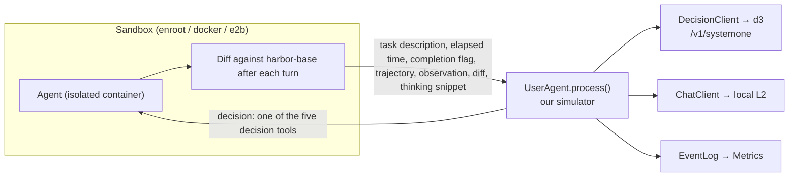

| Item | Approach | Status |
|---|---|---|
| Replace the user simulator | The interface is `UserAgent.process()`, to which the caller passes the task description, elapsed time, completion flag, trajectory, observation, diff, and thinking snippet; the simulator outputs one of five decision tools and is bounded by the `max_messages` cap. The diff is produced by the caller (`UserEnabledClaudeCode._capture_git_diff`) and is not in that file. Our simulator must implement the same calling interface | Model calls go through LiteLLM; whether they can point at our own endpoint needs testing |
| Model serving | L1 goes through DecisionClient (`/v1/systemone`) and L2 through ChatClient; both are local servers | SWE-Together's official docs support the vLLM backend only for the agent seat, and the user simulator goes through LiteLLM, so we must test whether it can connect to our own endpoints |
| Sandbox design | Reuse: the agent runs in an isolated container, the diff is taken against `harbor-base` after each turn, each agent turn is capped at 1800 s and the whole trial at 5400 s, and the per-turn diff handed to the simulated user is capped at 200k characters | — |
| Sandbox backends | enroot has enforced network control and is leaderboard-eligible; docker and e2b are all-or-nothing and for development only | — |
| Event hooks | v1 enables only `turn_end`; `write_attempt`, `plan_submitted`, and `permission_request` are reserved | Whether opencode provides permission or pre-write hooks is to be confirmed |
| AgentAdapter | Abstract with AgentAdapter so replay and live share the same simulator, and event log | — |
| Read-only inspect (T1) | Enabled only on live-dev, as a separate experiment (§1.4); the artifact list is filtered by the controller, and the simulator never accesses the container directly | — |

### 4.2 Task Set and Agents

| Item | Content |
|---|---|
| Task split | Split the 48 overlapping tasks into **live-dev** and **live-test** (split by task, fixed in advance; replay and live share the same split) |
| Purpose of the split | live-dev: usable for monitoring from Phase 2 on (no selections made from it), and the only data for dynamic-issue adjustment in live (§4.4); live-test: run once after freezing |
| Agents | At least two agents, one of which is **not in the training data's agent list**, to test generalization to new agents; k repetitions per task |
| Comparison | Also run SWE-Together's original simulator |

### 4.3 What Is Validated

| Item | Content |
|---|---|
| Dynamic stability | Error accumulation, repeated messages, memory drift, stopping behavior, parse failures and timeouts |
| Axis B | Compare live behaviour distributions with the real-user distribution on SWE-chat test, **standardized by agent turn type**; compare per-session rate distributions |
| Axis A | Live intent recall/precision and timing alignment |
| L2 in live | Run the evaluation discriminator, consistency, and leakage checks on live-generated messages; see whether the fine-tuned L2 stays stable when the distribution of agent outputs changes (diagnostic only, not part of final claims) |
| Agent confounding | Control for agent turn type in comparisons; report agent effects separately |
| New-agent generalization | Train on other agents, test on the held-out agent |
| Sensitivity | Deliberately perturb simulator behavior (e.g. no_op rate, disclosure delay) and see whether agent rankings and success rates change, to decide which gaps are decision-relevant |
| Reproduction check | Qualitative agreement with SWE-Together's original results (e.g. User Correction) |

Agent turn types with no real-user data to support them (e.g. permission requests, plan review) are marked "no calibration data".

### 4.4 Limits on Tuning in the Live Phase

| Allowed | Not allowed |
|---|---|
| Handle only dynamic issues replay cannot reveal: memory and state, repetition, stopping conditions, and how context is summarized in the prompt | **Do not re-tune action probabilities, example banks, or L2 realism settings** (those are finished and frozen in replay) |
| If adjustment is still needed, use only live-dev | live-test stays untouched |

### 4.5 Freezing and Final Evaluation

| Step | Content |
|---|---|
| 1. Freeze | L1, L2, discriminators, calibration artifacts and scoring rules; tag `v1-frozen` |
| 2. Evaluate | Run once each on SWE-chat test and live-test, report all metrics, and **make no further changes** |
| 3. Report | Baselines and the real-vs-real floor, results by agent turn type, per-agent results (diagnostic), comparisons across models and settings, turn types with no calibration data, and limitations |

### 4.6 Pass Criteria (Numeric Thresholds Set in Advance)

| # | Condition |
|---|---|
| 1 | Live and replay results show no serious contradiction |
| 2 | Axis A and B results beat the baselines and approach the real-user floor |
| 3 | The results still hold on the held-out new agent |
| 4 | Sensitivity analysis shows the conclusions are robust to reasonable realism error, or the non-robust behaviors are explicitly identified |

---

## 5. Work Order and Dependencies

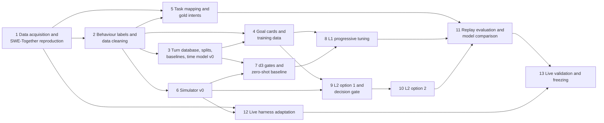

Work item 12 (live harness changes) can run in parallel with 8–11.

Recommended first step is a "minimal end-to-end version": about 20 checkpoints and 3 tasks, with no training, using zero-shot d3 and a prompt-based L2 to get the whole pipeline running, then adding fine-tuning and adversarial iteration step by step.

---

## 6. Risks, Open Items, and Follow-Up Extensions

### Open Items (to Confirm First)

| # | Item | Notes | Related section |
|---|---|---|---|
| 1 | Does d3 work on NVIDIA | Not officially verified on A100 or H200; also whether few-shot helps and whether fine-tuning is feasible (needed only when escalating to S3; by default we use chat-model LoRA instead) | §1.3, §3.1 |
| 2 | L2 option 1 or option 2 (LoRA) | Per the §3.5 decision gate | §3.5 |
| 3 | GPU | We have A100 and H200; whether the A100s are 40 or 80 GB, how many of each, and whether they share a machine is not yet confirmed | Appendix D |
| 4 | Sessions per agent in SWE-chat | Unknown; determines whether leave-one-agent-out is feasible | §2.7 |
| 5 | Mapping between SWE-Together tasks and SWE-chat sessions | Not yet verified | §2.8 |
| 6 | SWE-Together integration details | The simulator interface has been read (§1.4); still to confirm: how the harness injects messages into the agent (the caller `UserEnabledClaudeCode` is not in that file) and whether model calls can point at our own endpoint (via LiteLLM; needs testing) | §4.1 |
| 7 | opencode hooks | Whether it provides pre-write or permission-request hooks | §4.1 |
| 8 | Harness capabilities needed for interruption | Whether the harness can inject messages and cancel the agent mid-work is unverified; the fields of `queue_operation` and any hard-interrupt marker must be confirmed in the data | §1.8 |
| 9 | Behaviour label noise | The dataset's LLM-made labels are unverified and cap the quality of later comparisons; the simulator's labels are self-declared | §2.2 |
| 10 | Data access | The dataset requires login and acceptance of access conditions; our sandbox may not be able to download it directly | §2.1 |

### Risks

| Risk | Description | Mitigation |
|---|---|---|
| Privacy and memorization | The example bank puts real messages into prompts; if fine-tuning is done, the model also carries memorization risk | Anonymization, deduplication, and license confirmation |
| Hindsight bias in cards | The hidden-state goal cards are reconstructed with hindsight, and training and test cards differ in distribution, which may overstate the ability to "follow the card" | Ablation with card vs. history only; state the card condition in conclusions (§2.4) |
| Adversarial training | If option 2b is adopted, it is unstable, and discriminator realism does not equal correct behavior | An independent discriminator, hard constraints, and multiple metrics reported together (§3.5) |
| Population representativeness | SWE-chat comes from open-source developers on public GitHub repositories, so "similar to real users" can only be claimed for this population | State the population limit explicitly in conclusions |
| Agent mismatch | The agents real users used differ from the agents used in evaluation | Stratify on agent turn type and use leave-one-agent-out |
| Events without real data | Without real data for plan review and permissions, the corresponding parts of C and R can only rely on a later pilot | Mark as "no calibration data" |

### Follow-Up Extensions

| Extension | Content |
|---|---|
| **Interruption** | First use `queue_operation` to measure how often and when real users type while the agent is busy, then add the `user_interrupt` event; path and reservations in §1.8 |
| Plan review and permission events | Add the `plan_submitted` and `permission_request` blocking points; replies use existing actions, and AgentAdapter gains `respond()` |
| Human pilot | Calibrate review decisions, active time for retrieval and review, and the evidence sensitivity of R (RQ3, RQ4); pilot data can also add real-user data for the discriminator and L1 |
| K, B, P, A | Full annotation of K, and compliance tests on authored fixtures for B, P, and A |
| Tool permissions | Read-only inspect (T1) and run checks (T2) |
| Co-editing | The simulator modifies files; needs a new task split (SWE-Together excluded sessions where humans wrote most of the change) and a new grading method (§1.4 rule 7) |
| Two operating modes | Population-matched mode (behavior parameters sampled from the real distribution) and controlled mode (fixed parameters, repeatable stress tests) |

---

### Extension: Tagger and K/D/I/C Coding

Deferred from v1. The material below is the earlier design, kept for when it is picked up again. It also covers re-tagging consistency checks, K disclosure recall and leakage, and the D trigger-type and goal-revision L1 questions.

#### Coding Spec and Tagger

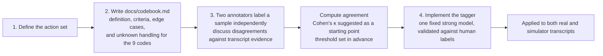

**Action set** (can be merged or trimmed based on real data): `no_op`, `answer`, `ask_clarification`, `new_requirement`, `redirect`, `approve`, `deny`, `inspect`, `accept`, `reject`, `request_evidence`, `defer`, `check_external`, `dont_know`.

**Status of the 9 codes in this plan**　✓ yes　△ partial　✗ no

| Code | How well SWE-chat can be annotated | First-version treatment |
|---|---|---|
| D Disclosure | ✓ Yes | Full (conditional behavior) |
| I Intent | ✓ Yes (needs humans; the data already has a coarse `prompt_intent`) | Full |
| C Channel and timing | △ Partial (chat; `first_write_position` tells before vs. after the first write; no records for plans and permissions) | Limited |
| R Review and response | △ Partial (responses to the agent's completion claims) | Limited (coarse accept vs. correct) |
| K Knowledge and access | △ Inference only | Subset; unknown listed separately |
| B Belief | ✗ Correctness cannot be judged | Authored fixtures only |
| P Authority | △ Partial | Partial; compliance testing mainly |
| A Attention | ✗ Not possible | Simulator state only |
| E Effort | △ Partial (timestamps approximate response latency) | Time-model calibration |


#### Diagnostic Flow

Do not use the rates of D, I, C, and R as direct tuning targets (to avoid circularity); instead use them on dev to locate which layer is failing:

| Code | Symptom | Most likely layer | What to adjust |
|---|---|---|---|
| D | Low disclosure rate after targeted questions | L1 | Action calibration for that agent turn type; training-data balance |
| D | Right action but the fact is missing or too vague | Policy table or L2 | Release rules; L2's required-fact constraint and training data |
| D | Over-disclosure or leakage | L2 | Constraint reward and leakage filtering |
| I | Too few or too many revisions | L1 | Probabilities of new_requirement and redirect |
| I | Revision content looks wrong | Task setup | Edit the fixture or goal card; not a statistical adjustment |
| C | Intervention timing is late | Checkpoint design | Event types and consultation points |
| R | Accepts too easily | L1 | Calibration for the "agent claims completion" turn type |
| R | Insensitive to evidence | Data limitation | Do not tune on SWE-chat; defer to the pilot |

One exception: the **conditional probabilities** that produce them (for example "probability of disclosing after a targeted question") can be fit directly on train/dev, because they are conditional behavior parameters, not aggregate rates.


## Appendix A: Example Config

```yaml
experiment: replay_l1_s2_l2_opt1_v0
data: {checkpoints: data/processed/checkpoints_v1.parquet, split: dev}   # test needs --final
simulator:
  visibility_profile: SWT            # SWT (default, matches SWE-Together) | P0–P3
  tools: [none]                      # none | inspect (live only)
  consult_on: [turn_end]             # tool_boundary reserved (§1.8)
  l1:
    endpoint: http://localhost:8000/v1/systemone
    model: vllm-sr/d3-mini
    revision: <commit-hash>          # must be pinned
    stage: S2                        # S0 | S1 | S2 | S3
    questions: [behaviour, disclose_fact]
    fewshot: {bank: models/fewshot/l1_bank_<version>, k: <chosen on dev>}   # S1
    calibration: models/calib/d3-mini_<version>.json                        # S2
  l2:
    option: 1                        # 1 | 2a | 2b
    model: <local-model-name>
    api_base: http://localhost:8001/v1
    length_model: models/stats/length_<version>.json
    fewshot: {bank: models/fewshot/l2_bank_<version>, k: <chosen on dev>}
    adapter: null                    # fill only for option 2 (LoRA weights)
evaluation: {discriminator: disc/eval_<version>}   # required; kept separate from any training or re-ranking discriminator (§3.5)
seed: 0
```

## Appendix B: DecisionClient Request Sketch

Follows the format on the official recipe page (`criteria`, `noul`). `examples` goes inside state and is used only in the few-shot stage (S1); the official docs do not say whether this works. The response gives, per question, the choice, per-option probabilities, and `confidence`; field names go by testing; request limits are in §1.3.

```json
{
  "model": "vllm-sr/d3-mini",
  "state": {"agent_turn_type": "asks_question", "agent_turn_summary": "...", "recent_user_messages": ["..."],
            "facts": [{"id": "F2", "status": "undisclosed", "holder": "privately_retrievable"}],
            "authority": {"may_approve": ["read"], "may_deny": ["delete"]}, "examples": []},
  "questions": {
    "behaviour": {"type": "choice", "instructions": "What is the user most likely to do now?",
               "criteria": {"no_op": "Stay silent", "non_pushback": "Send a message without pushing back", "correction": "Correct the agent", "failure_report": "Report that something failed", "rejection": "Reject the work"}},
    "disclose_F2": {"type": "noul", "instructions": "Will the user disclose F2 now?"}
  }
}
```

## Appendix C: Sources

- SWE-Together (arXiv 2606.29957): https://arxiv.org/pdf/2606.29957 ; code: https://github.com/Togetherbench/SWE-Together
- Measuring and Mitigating the Distributional Gap Between Real and Simulated User Behaviors (arXiv 2605.07847): https://arxiv.org/pdf/2605.07847
- SWE-chat (arXiv 2604.20779): https://huggingface.co/datasets/SALT-NLP/SWE-chat
- vLLM Semantic Router Decision 3.0 (d3): https://huggingface.co/vllm-sr/d3 ; https://recipes.vllm.ai/vllm-sr/d3
- ModernBERT or DeBERTaV3? (arXiv 2504.08716, encoder comparison): https://arxiv.org/abs/2504.08716
- Claude Code hooks documentation: https://code.claude.com/docs/en/hooks.md
- Claude Code queueing and interrupt behavior differences (GitHub issues #36326, #52509, #67191): https://github.com/anthropics/claude-code/issues
- RAID (arXiv 2405.07940, robustness benchmark for detectors): https://arxiv.org/abs/2405.07940
- Binoculars (arXiv 2401.12070, zero-shot machine-text detection): https://arxiv.org/abs/2401.12070
- Can We Trust LLM Detectors? (arXiv 2601.15301, detectors under domain shift): https://arxiv.org/abs/2601.15301
- Attacking Only Half the Data (arXiv 2610.18151, misflagging of short texts): https://arxiv.org/abs/2610.18151
- SimulatorArena (EMNLP 2025): https://aclanthology.org/anthology-files/pdf/emnlp/2025.emnlp-main.1786.pdf
- MirrorBench (arXiv 2601.08118, human-likeness benchmark for user proxies): https://arxiv.org/abs/2601.08118

---

## Appendix D: GPU Memory Estimates (Summary)

**Premises**: A100 (40 or 80 GB, unconfirmed) and H200 (141 GB) are available; the number of cards and whether they share a machine are unknown, so the estimates are for a **single card**. vLLM reserves 92% of GPU memory by default (about 37 GiB on A100 40 GB, 74 GiB on A100 80 GB, 129 GiB on H200). Weights and KV cache follow formulas; the d3 27B peak is an official measurement; other serving overheads and training needs are extrapolations or rules of thumb and need testing. d3 is not officially verified on NVIDIA, and A100 has no native FP8.

**Inference (reserved memory, GiB)**

| Service | Reserved estimate | Cards that fit |
|---|---|---|
| d3-lite / nano / mini / flash | about 8 / 12 / 17 / 26 | All three cards |
| d3 27B | 62–65 (official measurement) | H200; A100 80 GB barely (the whole card must go to it) |
| L2 about 8B | BF16 about 25; INT4 about 14 | All three cards |
| L2 about 30B | BF16 about 71; INT4 about 30 | BF16 needs H200; INT4 fits A100 80 GB |

Same-card combinations: d3-mini/flash + L2 8B is about 42–51 GiB and needs A100 80 GB or larger; d3 27B + L2 8B (about 90 GiB) or d3 27B + L2 30B INT4 (about 95 GiB) needs H200; d3 27B + L2 30B BF16 (about 136 GiB) does not fit on one card.

**Training (rules of thumb, wide ranges)**

| Job | Estimate (GiB) | Cards needed |
|---|---|---|
| Discriminator (0.1–0.5B encoder, or 1–2B + LoRA) | 4–12 | Any |
| L2 8B QLoRA / LoRA (BF16) | 12–20 / 25–40 | QLoRA on any; LoRA preferably A100 80 GB or larger |
| L2 30B QLoRA / LoRA (BF16) | 30–40 / 76–96 | QLoRA preferably A100 80 GB or larger; LoRA needs H200 |
| L2 option 2b: methods A / B / C (8B) | 35–55 / 35–55 / 50–90 | A/B need A100 80 GB or larger; C needs H200 |
| L1 d3 LoRA (mini / flash / 27B, only if d3 fine-tuning is feasible) | 19–29 / 28–41 / 69–89 | 27B needs H200 |

**d3 compute**: prefix caching is off and each question is a full forward pass, so total prefill tokens ≈ number of checkpoints × questions per checkpoint × prompt length (e.g. 10,000 × 4 × 4,000 = 160 million tokens). Throughput on NVIDIA is unknown and needs testing; adding mid-turn consultation points (§1.8) multiplies the number of queries, so a gate is needed.

**Recommended allocation (pending confirmation of GPU count and model)**: H200 for 27B-class experiments, L2 30B LoRA, and reinforcement learning for 2b; A100 80 GB for replay evaluation serving (d3-mini/flash + L2 8B), 8B LoRA/QLoRA, discriminators, and 2b methods A/B; A100 40 GB for a single small service, QLoRA, and discriminators. With two or more cards, use one for serving and one for training so they do not compete for memory.

---

## Appendix E: Metric Formulas (Intent Coverage and Distribution Gap)

The reference implementation `metrics_ref.py` is attached separately (checked against the two worked examples in this appendix: Intent Coverage gives 0.86; KL, JS, TV give 0.1046, 0.0915, 0.0242, 0.20).

### E.0 Comparison with the Original Papers

The formulas build on the two papers, but several choices are not specified by the papers and are added by this plan; each is marked below.

| Item | Original paper | This plan |
|---|---|---|
| **Intent Coverage: combination** | SWE-Together §2.3.2: IntentCoverage = round(0.70·Irecall + 0.30·Iprecision, 2) | Keep this combination and these weights |
| recall | Called weighted intent recall; how the weights are set is not explained in the parts I read | Equal weights by default (ω = 1), with a weighting hook; weights to be checked against its scoring script |
| precision | Called scope precision (whether the simulator's guidance stays within the original user's scope) | Defined as "the share of non-no_op messages that fall within some gold intent"; may differ from the original definition, to be checked against its scoring script |
| matcher | Not specified (LLM judge, human, or rules) | A fixed strong model, validated by spot-checking against human labels |
| One-to-one or many-to-one | Not specified | Report one-to-one as the primary, and many-to-one alongside |
| Position window | Not specified | **Added by this plan** (unit: agent turns), registered in advance |
| Aggregation | Scored per replayed trial; how replicates and tasks are averaged is not stated | trial → task (mean over k repeats) → equal-weight mean across tasks |
| **Distribution gap: what the distribution is over** | Mehri et al.: an LLM writes a behavior description for each conversation, which is embedded (Qwen3-Embedding-8B, truncated to 1024 dimensions), reduced with PCA, and clustered with k-means (k = 500); P and Q are the real and simulated proportions per cluster | Discrete behaviour labels, computed within each agent turn type; the embedding-cluster version can serve as a message-level supplement (same formulas) |
| Divergences | forward KL, backward KL, JS; no TV or Wasserstein | The same three, plus TV (an intuitive 0–1 scale) |
| Smoothing | Laplace smoothing with α = 1/k on all KL-type metrics | α = 1/\|A\| (total pseudo-count of 1), with a sensitivity check on α |
| Aggregation across conditions | Reported separately per dataset; no pooled score across tasks | Computed within agent turn types first, then summed with fixed weights |
| Confidence intervals | No CI, bootstrap, or significance test reported | Developer-level bootstrap |
| Lower bound | Each real conversation is paired with a goal-similar conversation from a held-out WildChat subset | Split the real data in half by developer, repeated many times |

Note: I read only the first roughly 100,000 characters of the Mehri et al. page (the full text is about 144,789 characters), so the appendix may hold more detail; I have not yet read SWE-Together's scoring script either. Both are listed as to-dos.

### E.1 Intent Coverage (Axis A)

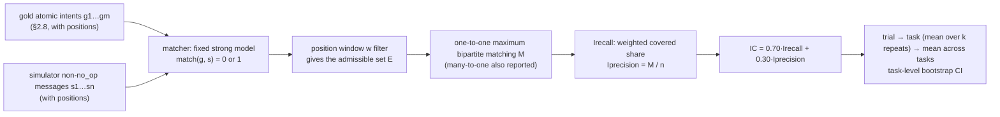

**Notation**

| Symbol | Meaning |
|---|---|
| t, r | Task, repeat index |
| G = {g₁…g_m} | Gold atomic intents of task t (§2.8), with position pos(gᵢ) in agent turns |
| S = {s₁…s_n} | The simulator's non-no_op messages in that repeat, with position pos(sⱼ) |
| match(gᵢ, sⱼ) ∈ {0, 1} | The matcher's verdict |
| w | Position window (in turns), registered in advance |
| ωᵢ | Weight of a gold intent, default 1 |

**Formulas**

```
Admissible set   E = { (i, j) : match(gᵢ, sⱼ) = 1  and  |pos(sⱼ) − pos(gᵢ)| ≤ w }

One-to-one (primary)
  M          = size of a maximum bipartite matching on E
  Irecall    = Σ_{i matched} ωᵢ / Σ_i ωᵢ
  Iprecision = M / n

Many-to-one (looser, also reported)
  Irecall    = (1/m) · Σ_i 1[ ∃j : (i, j) ∈ E ]
  Iprecision = (1/n) · Σ_j 1[ ∃i : (i, j) ∈ E ]

IC = 0.70 · Irecall + 0.30 · Iprecision
F1 = 2 · Irecall · Iprecision / (Irecall + Iprecision)
```

Difference between the two: under many-to-one, if the simulator states the same intent twice, both messages count as "precise"; one-to-one counts only one, so repeated messages lower precision.

**Edge cases (this plan's settings)**: tasks with m = 0 are excluded; when n = 0 (the simulator stays silent throughout), Iprecision is set to 0 and the share of silent tasks is reported separately.

**Aggregation**

```
IC_task = (1/K) · Σ_r IC_{t,r}                  (K repeats)
IC      = (1/T) · Σ_t IC_task                    (tasks equally weighted, T tasks in the split)
Confidence interval: bootstrap over tasks (B = 1000), 2.5% to 97.5% percentiles
```

**Related quantities (this plan's definitions)**

```
Action-type recall / precision: as above, with match replaced by "same action type" (window still applies)
Timing alignment    Δ = (1/M) · Σ_{(i,j) ∈ matched pairs} | pos(sⱼ) − pos(gᵢ) |          (turns)
K disclosure recall = number of private facts disclosed / number of private facts that should be disclosed
K leakage rate      = number of facts disclosed before their release condition holds / total facts disclosed
```

**Worked example**: m = 5, n = 4, one-to-one matches M = 4: Irecall = 4/5 = 0.80, Iprecision = 4/4 = 1.00, IC = 0.70 × 0.80 + 0.30 × 1.00 = 0.86, F1 ≈ 0.89.

### E.2 Distribution Gap (Axis B)

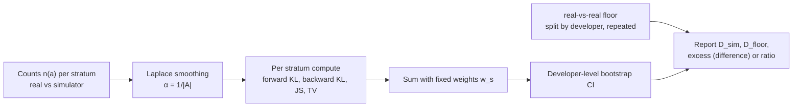

**Notation**

| Symbol | Meaning |
|---|---|
| A | The set of categories (the behaviour label set) |
| s ∈ 𝒮 | Agent turn type (§2.6); one stratum per type |
| nᴿₛ(a), nˢₛ(a) | Counts of category a within stratum s for real users and the simulator; Nᴿₛ = Σₐ nᴿₛ(a) |

**Formulas (natural log, units of nats)**

```
Smoothing   Pₛ(a) = ( nᴿₛ(a) + α ) / ( Nᴿₛ + α·|A| ), Qₛ(a) likewise for the simulator, α = 1/|A|

Forward KL   D_F,s = KL(Pₛ ‖ Qₛ) = Σₐ Pₛ(a) · ln( Pₛ(a) / Qₛ(a) )
Backward KL  D_B,s = KL(Qₛ ‖ Pₛ) = Σₐ Qₛ(a) · ln( Qₛ(a) / Pₛ(a) )
JS           D_J,s = ½·KL(Pₛ ‖ Mₛ) + ½·KL(Qₛ ‖ Mₛ), Mₛ = (Pₛ + Qₛ) / 2          (range 0 to ln 2)
TV           D_T,s = ½ · Σₐ | Pₛ(a) − Qₛ(a) |                                    (range 0 to 1)

Aggregation across strata   D = Σₛ wₛ · Dₛ,   wₛ = Nᴿₛ / Σₛ' Nᴿₛ'
  Weights are the proportions of each turn type in the test set, fixed in advance and not changed by the simulator
```

**Interpretation**

| Metric | What a high value means | Type |
|---|---|---|
| Forward KL (KL(real ‖ simulator)) | The simulator misses behaviors real users show | Recall-type (Mehri et al.'s reading) |
| Backward KL (KL(simulator ‖ real)) | The simulator shows behaviors real users rarely show, e.g. talking too much or over-disclosing | Precision-type (same) |
| JS | Either failure raises it | Symmetric |
| TV | The probability mass that must be moved | Intuitive and bounded |

**Floor and excess**

```
D_floor: split the real data at random in half by developer (H₁, H₂), take P from H₁ and Q from H₂,
         compute with the same formulas and weights; repeat R times (e.g. R = 100) and average
Report:  D_sim, D_floor, and  excess = D_sim − D_floor  (or  ratio = D_sim / D_floor )
```

When comparing D_sim with D_floor, the sample sizes on both sides should be comparable (subsample the larger side), because the plug-in KL estimator has a positive finite-sample bias, to first order about (|A| − 1) / (2N), larger when samples are fewer.

**Confidence intervals**: resample developers (B = 1000). In replay, the simulator's outputs correspond one-to-one to real checkpoints, so they are resampled together with the developers; in live, resample tasks. Recompute D (including the weights) on every resample and take the 2.5% to 97.5% percentiles.

**Per-session rate distributions (including dispersion)**

```
rᵤ(a) = number of checkpoints in session u with action a / number of checkpoints in session u
Compare { rᵤᴿ(a) }ᵤ with { rᵤˢ(a) }ᵤ:
  W₁ = ∫ | F_R(x) − F_S(x) | dx              (Wasserstein-1; F is the empirical CDF)
  KS = supₓ | F_R(x) − F_S(x) |
  dispersion ratio = σ_S(a) / σ_R(a)          (σ is the standard deviation of per-session rates; 1 means equal heterogeneity)
```

**Conditional behavior**

```
Δ_cond(x | c) = P_S(x | c) − P_R(x | c)
e.g. x = disclose a fact, c = the agent asks a targeted question; confidence intervals as above
```

**Worked example**: A = {no_op, answer, other}, real P = (0.60, 0.30, 0.10), simulator Q = (0.80, 0.15, 0.05) (unsmoothed): forward KL ≈ 0.105 nats, backward KL ≈ 0.092 nats, JS ≈ 0.024 nats, TV = 0.20. The simulator prefers silence and underweights answer and other.

### E.3 To Confirm

| # | Item | Approach |
|---|---|---|
| 1 | SWE-Together's scoring script | Confirm the matcher, one-to-one vs many-to-one, position window, recall weights, and the actual definition of precision, and adjust §E.1 if needed |
| 2 | Mehri et al.'s appendix | Read the full text and confirm the other details of smoothing, clustering, and the lower bound |
| 3 | Pre-registration | Register the position window w, the smoothing coefficient α, the bootstrap count B, and the floor repeat count R before seeing any test results |
| 4 | K disclosure recall and leakage rate | Definitions set by this plan; they must be aligned with the K code (deferred extension) |
