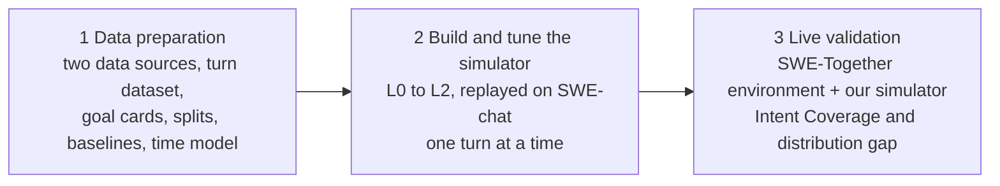
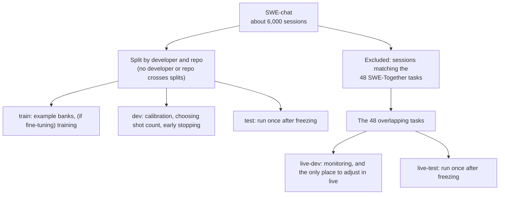
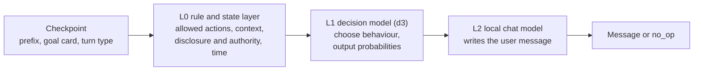
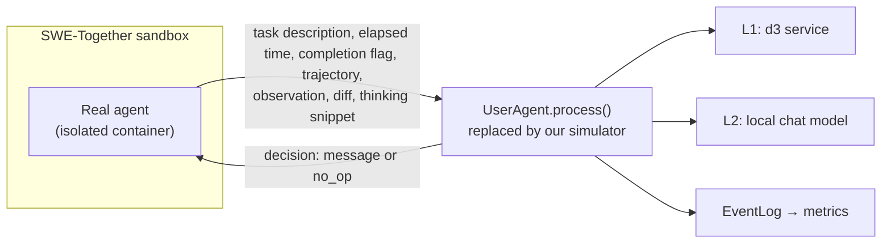

# Simulator Build and Validation Plan (Lite)

Version v0.8-lite · 2026-11-26 (tagger and K/D/I/C coding moved to extensions) · Companion to the proposal "Benchmarking human-AI teaming in coding" (simulator portion of RQ4)

> Diagrams use Mermaid. Symbols: ✓ feasible, △ partial or unconfirmed, ✗ not feasible.

---

## Goal and Evaluation Axes

Build a coding-user simulator that is primarily local-model-based and fine-tunable, and validate its similarity to real users along two axes:

| Axis | What is compared | Method |
|---|---|---|
| **A: single-task coverage** | On the same task, whether the simulator covers the original user's intents | SWE-Together's Intent Coverage |
| **B: cross-task behavior distribution** | Across all tasks, the gap between simulator and real users in behaviour distributions | The distribution-gap method of Mehri et al. (KL, JS, TV) |



---

## 1. Data Preparation

### 1.1 Two Data Sources

| Data | Content | Use |
|---|---|---|
| **SWE-chat** | About 6,000 real sessions of users working with coding agents (Hugging Face `SALT-NLP/SWE-chat`, odc-by, still growing, so pin a version) | Example banks, calibration and (if needed) fine-tuning; the real distribution for Axis B; replay mode |
| **SWE-Together** | 109 tasks with Docker environments and grading (Apache-2.0) | Axis A and live validation |
| **The 48 tasks present in both** | Have both an environment and the full original session | Main data for Axis A; **never used for training or tuning decisions** |

### 1.2 Build the Turn Dataset

A checkpoint is placed at the end of every agent turn; the real action is "the next user message" or "silence (no_op)".

| Item | Content |
|---|---|
| Include silence | Without silent checkpoints, the simulator's tendency to talk too much cannot be measured |
| Recorded per checkpoint | Prefix (summarized and truncated, with no view of the future), agent-turn type and features, real action and behaviour label, user latency, whether the first write has appeared |
| Agent-turn type | A few types decided mechanically from tool calls (ends with a question, claims completion, reports an error, large edit, ordinary progress, and so on); comparisons are stratified by type to remove differences in agent composition |
| Queued messages | SWE-chat's `queue_operation` (`user_prompt_enqueued`, `delivered`, `discarded`) is recorded separately for a possible interruption feature later |

### 1.3 Behaviour Labels (v1)

No tagger and no K/D/I/C coding in v1 (see Extensions). Stage 2 and 3 compare behaviour distributions only.

- **Labels**: `no_op`, `non_pushback`, `correction`, `failure_report`, `rejection`. `no_op` is mechanical; the other four are SWE-chat's own `prompt_pushback` labels. Missing labels are `unlabeled`, never guessed.
- **Simulator side**: L1 chooses the label directly.
- **Cleaning**: harness-written rows (interrupts, slash commands, image-only rows, automated review sessions) are removed.
- **Limits**: dataset labels are LLM-made and unverified; the simulator's label is self-declared; no annotator agreement.


### 1.4 Rebuild the Goal Card

A goal card is a per-session hidden state (hidden from the agent, visible to the simulator) that lets the simulator act on "what the user knows and wants".

| Item | Content |
|---|---|
| Content | Objective, constraints, facts the user privately knows (with holder and retrieval path), intervention conditions |
| SWE-chat | Rebuilt from the whole session by a **local model** (configured in `.env`), with **no verbatim copying of later user messages**; fields and generation method aligned with SWE-Together's session analysis to narrow the train/test card distribution gap |
| The 48 overlapping tasks | Use SWE-Together's existing session analysis directly; do not rebuild |
| Leakage audit | Compare n-gram overlap between the card and later messages; spot-check by humans |
| Known risk | Cards are written in hindsight, so a model may learn to "follow the card"; hence an ablation of "with card" vs. "history only" |

### 1.5 Pre-Split the Data



- All tuning uses train and dev only; the split is frozen and versioned at the end of Phase 1.
- Leave-one-agent-out folds are prepared in advance to test generalization to new agents.
- Replay and live share the same live-dev / live-test split (a setting of this plan, which can be changed).

### 1.6 Build Baselines and the Noise Floor

| Item | Content |
|---|---|
| Baselines | Always no_op, sample by empirical frequency (per turn type), persona-only LLM, zero-shot d3, prompt-based local chat model |
| **Real-vs-real floor (distribution)** | Randomly split real data in half by developer, compute the distribution gap between the halves, and repeat many times (for example 100) and average |
| **Real-vs-real floor (discriminator)** | Train a discriminator to tell apart "real messages from different developers"; its accuracy is the reference for the discriminator evaluation |

The floor is a reference for interpretation ("how close is close enough"), not a tuning target.

### 1.7 Build the Time Model

| Item | Content |
|---|---|
| Agent turn duration | Taken directly from SWE-chat timestamps (the actual run time in live), never estimated |
| Simulator-side reply and typing time | A pure function from events to seconds, calibrated on real user latency with median and trimmed handling; the simulator's own wall-clock is not used |
| Retrieving evidence, reviewing a patch | Cannot be observed in transcripts; left to a later human pilot |

---

## 2. Build and Tune the Simulator

### 2.1 Simulator Architecture



| Layer | Implementation | Job |
|---|---|---|
| **L0** | Rule-based state controller (no model) | Track user state; provide the actions allowed this turn and the context (action-eligibility mask); manage fact-disclosure rules, authority scope, attention budget, and time accumulation; summarize or truncate agent output; stop at the message limit |
| **L1** | d3 (vLLM Semantic Router Decision 3.0) | Answer typed questions (which behaviour, whether to disclose a fact now) and return per-option probabilities; no text generation |
| **L2** | Local chat model | From the L1 result and the facts allowed to be disclosed, write a message close to a real user's |
| L3 (control) | A single local model end to end | Tests whether splitting into L1 + L2 actually helps |

**L1 tuning ladder**: S0 zero-shot → S1 few-shot (examples from train) → S2 adjust probabilities (calibration, data from dev) → S3 fine-tune. Escalate only if the previous stage is not enough, and do not stack an ineffective stage; if d3 cannot be fine-tuned, fine-tune a local chat model with LoRA as L1.

**L2: two options (pending decision)**

| Option | Content |
|---|---|
| 1. Length distribution + few-shot + persona | No weight updates: estimate the length distribution for "action × turn type" from train and sample a target length; retrieve real messages with the same action, the same turn type, and a similar state as few-shot examples; group by persona |
| 2. LoRA fine-tuning | 2a: LoRA fine-tune "(state, action, allowed facts) → real message"; 2b (optional): add an adversarial extension that uses a discriminator's signal to iteratively update L2 |

How to choose: evaluate option 1 first; adopt it if it meets the thresholds, otherwise evaluate 2a, and evaluate 2b only if resources allow; whichever is chosen, report both options (ablation).

### 2.2 Tune One Turn at a Time (Replay)

Compare checkpoint by checkpoint on real SWE-chat sessions (teacher-forced): the simulator sees only the real prefix, its output is discarded, and the next checkpoint still uses the real history. The result is an upper bound on single-step fidelity and is not used to predict live performance.

| Target | Metrics | Compared against |
|---|---|---|
| **L1: behavior** | log loss, Brier, macro-F1, calibration error (ECE) | Baselines |
| **L1: behaviour distribution** | Within each turn type, KL, JS, and TV of the behaviour distributions; per-session rate distributions; conditional behaviour (for example correction rate after a completion claim) | Real users and the real-vs-real floor; aggregated with fixed weights (the turn-type proportions in the test set), with developer-level bootstrap intervals |
| **L2: discriminator** | Accuracy and AUC of the evaluation discriminator (evaluated alone with the real action as input) | The real-vs-real (different developers) floor |
| L2: other | leakage rate, style distribution, diversity | The real distribution |

**Tuning rules**
- The evaluation discriminator is mandatory and independent: its architecture differs from any training or re-ranking discriminator, it is trained only after the generator is frozen, trained on train and evaluated on test; the primary model is DeBERTa-v3, with ModernBERT and a surface-feature model as cross-checks.
- Behaviour rates are not direct tuning targets beyond the L1 ladder.
- All tuning uses train and dev only, one knob at a time, with a manifest recorded; the 48 overlapping tasks are not used for tuning, and Axis A numbers are only monitored on live-dev at this stage.

**Conditions to enter live (numeric thresholds set in advance)**: the action layer beats the empirical-frequency baseline; the distribution gap within each turn type is close to the real-vs-real floor; the L2 discriminator accuracy is close to the floor, with leakage and diversity on target; leakage and parse-failure rates are below thresholds; turn types without real data are marked "no calibration data".

---

## 3. Live Validation

### 3.1 Run in the SWE-Together Environment with Our Own Simulator



| Item | Content |
|---|---|
| How it is replaced | Keep SWE-Together's sandbox, grading, and `max_messages` limit; implement the same `UserAgent.process()` interface; an AgentAdapter lets replay and live share the same simulator, and event log |
| Observation and tools | By default the same information SWE-Together's simulator sees (SWT profile); no file modification and no direct environment access |
| Tasks and agents | Split the 48 overlapping tasks into live-dev and live-test; at least two agents, one of which is not in the training data to test generalization; k repeats per task; SWE-Together's original simulator is also run as a comparison |
| Limits on live adjustment | Only fix dynamic problems that replay cannot show (memory and state, repetition, stopping conditions, how context is summarized), and only on live-dev; **do not re-tune action probabilities, example banks, or L2 settings** |
| Freezing and final evaluation | Freeze L1, L2, the discriminator, calibration artifacts, and the scoring rules (`v1-frozen`); run once each on SWE-chat test and live-test, with no further tuning |

### 3.2 What Is Validated

| Item | Content |
|---|---|
| **Intent Coverage (Axis A)** | Per task, whether the gold atomic intents are expressed by the simulator at the corresponding position (recall), and how many of the simulator's messages fall within some gold intent (precision); `IC = 0.70·Irecall + 0.30·Iprecision`; computed per task, with task-level bootstrap intervals |
| **Distribution gap (Axis B)** | Compare live behaviour distributions with the real distribution from SWE-chat test, **standardized by turn type**, against the real-vs-real floor; each item is reported separately, with no combined score |
| Dynamic stability | Error accumulation, repetition, memory drift, stopping time, parse failures and timeouts |
| Reporting | Baselines and floor, results by turn type, per-agent results (diagnostic), turn types with no calibration data, limitations |

Pass criteria (numeric thresholds set in advance): live and replay results do not seriously contradict each other; Axes A and B beat the baselines and approach the real-user floor; the results still hold on a held-out new agent.

---

## Extensions (Deferred)

### Build the Tagger and the 9 Codes (Only What Can Be Tagged)

The codebook defines 9 codes, but only part of them can be tagged on SWE-chat; the tagger applies them to both real and simulated messages.

| Code | Meaning | Taggable on SWE-chat | First-version handling |
|---|---|---|---|
| **D** Disclosure | Which facts are revealed, and under what trigger | ✓ | Full |
| **I** Intent | What the user wants, and whether the goal is revised | ✓ | Full |
| **C** Channel and timing | Which channel and when the user intervenes | △ chat only; timing from before vs. after the first write | Limited |
| **R** Review and response | Response to the agent's completion claims | △ | Limited (coarse accept vs. correct) |
| **K** Knowledge and access | What the user knows and how it can be retrieved | △ inference only | Subset; unknown listed separately |
| **P** Authority | What the user permits or denies | △ | Partial, mainly compliance testing |
| **E** Effort | Time and effort of a response | △ latency approximated from timestamps | Handled by the time model |
| **B** Belief | What the user believes (possibly wrong) | ✗ correctness cannot be judged | Authored test fixtures only |
| **A** Attention | Attention budget | ✗ | Simulator internal state only |

- **Annotation style**: each message is assigned to a closed category (including unknown and other); free-text rationales are kept only for auditing.
- **Tagger**: one fixed strong model, from a model family different from L2 and d3, with the version pinned; two annotators label a sample and agreement is computed, then the tagger is validated against human labels, separately on real and simulated messages.
- K, D, I, C rates feed the Axis B comparison; B, P, A, E are mainly simulator internal state.
---

## Appendix A: Metric Definitions

**Intent Coverage (Axis A)**

```
G = {g1…gm}: the task's gold atomic intents, with position pos(g) counted in agent turns
S = {s1…sn}: the simulator's non-no_op messages
Pairable set  E = { (i, j) : match(gi, sj) = 1  and  |pos(sj) − pos(gi)| ≤ w }   (match is decided by a fixed strong model)
One-to-one (primary): M = size of the maximum bipartite matching on E
  Irecall = sum of weights of matched gold intents / sum of all gold weights (weight 1 by default)
  Iprecision = M / n
IC = 0.70 · Irecall + 0.30 · Iprecision
```

Tasks with m = 0 are excluded; when n = 0 (silent throughout), Iprecision is 0 and the share of silent tasks is reported separately.

**Distribution gap (Axis B)**

```
Within each turn type s, P is real users and Q is the simulator over category set A (Laplace smoothing, α = 1/|A|)
Forward KL   KL(P ‖ Q): the simulator misses behavior real users show (recall-type)
Backward KL  KL(Q ‖ P): the simulator does things real users rarely do (precision-type)
JS (range 0 to ln 2), TV = ½·Σ|P − Q| (range 0 to 1)
Aggregate across turn types with fixed weights (the turn-type proportions in the test set)
Report: D_sim, D_floor, and excess = D_sim − D_floor (or the ratio)
```

The floor D_floor comes from repeated developer half-splits; both sides must have comparable sample sizes (the finite-sample bias of KL is about (|A|−1)/(2N)); confidence intervals resample developers (B = 1000).

---

## Appendix B: To Confirm

- Whether d3 works on NVIDIA GPUs (officially tested only on AMD), and whether d3 few-shot and fine-tuning are feasible.
- GPU models and counts (A100 at 40 or 80 GB, H200, and whether they share a machine).
- The mapping between the 48 SWE-Together tasks and SWE-chat sessions, and details of SWE-Together's scoring script (matcher, position window, weights).
- Whether SWE-Together's harness can be pointed at our own simulator endpoint (LiteLLM).

---

## Appendix C: Sources

- SWE-Together (arXiv 2606.29957): https://arxiv.org/pdf/2606.29957 ; https://github.com/Togetherbench/SWE-Together
- Measuring and Mitigating the Distributional Gap Between Real and Simulated User Behaviors (arXiv 2605.07847): https://arxiv.org/pdf/2605.07847
- SWE-chat (arXiv 2604.20779): https://huggingface.co/datasets/SALT-NLP/SWE-chat
- vLLM Semantic Router Decision 3.0 (d3): https://huggingface.co/vllm-sr/d3
