# Simulator 建置與驗證計畫（三階段）

版本 v0.8 · 2026-11-26（tagger 與 K/D/I/C 編碼移到後續擴充） · 對應提案：Benchmarking human-AI teaming in coding（RQ4 的 simulator 部分）

> 閱讀提示：圖採 Mermaid 格式（GitHub、VS Code、Obsidian、Typora 可直接渲染）；符號 ✓ 已確認／可行、△ 部分或未確認／勉強、✗ 不可行。

---

## 0. 摘要

**目標。** 建立以本地模型微調為主的 coding 使用者 simulator，並從兩個面向驗證它與真實使用者的相似度：

| 面向 | 比較什麼 | 參考方法 |
|---|---|---|
| **A：單一任務 coverage** | 在同一任務下，simulator 對原始使用者的意圖與行動的覆蓋程度 | SWE-Together 的 Intent Coverage |
| **B：跨任務行為分布** | 在所有任務下，simulator 與真人的行為分布差距（§2.2 標籤） | Mehri et al. 的分布差距方法 |

### 三階段總覽

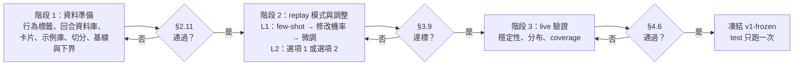

| 階段 | 內容 |
|---|---|
| 1 資料準備 | 行為標籤、回合資料庫、隱藏狀態卡片、示例庫與（視需要）訓練資料、切分、基線與雜訊下界 |
| 2 replay 模式與 simulator 調整 | 在真實 agent 回合上逐個決策點比較；L1 依 few-shot → 修改機率 → 微調遞進；L2 在兩個選項（長度分布＋few-shot＋persona／LoRA 微調）間決定 |
| 3 live 驗證 | 在 SWE-Together 環境中讓 simulator 與真實 agent 互動，驗證穩定性、分布與 coverage，再凍結並做最終評估 |

### 資料分工與切分

| 資料 | 用途 | 模式 |
|---|---|---|
| SWE-chat（約 6,000 個真實 session，持續增長） | 示例庫與校準資料；（視需要）微調；做面向 B | replay（teacher-forced） |
| SWE-Together（109 個任務，含 Docker 環境） | 面向 A 與 live 驗證 | replay + live |
| 兩者重疊的 48 個任務 | 同時有環境與完整原始 session，面向 A 的主要資料；**不進入任何訓練，也不用於調整決策**（用法見 §2.7） | replay + live |

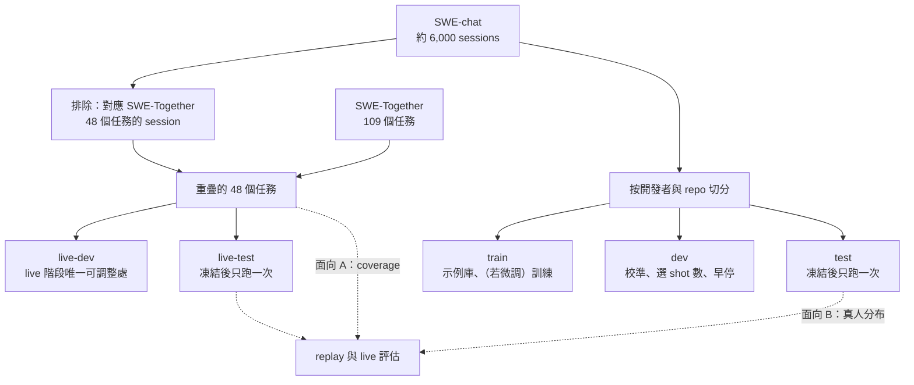

### 核心設計決定

| 決定 | 內容 |
|---|---|
| 回合制 | 每個 agent 回合結束後詢問 simulator 一次；介面以事件為單位，預留日後的打斷（路徑見 §1.8） |
| 動作與語言分開 | **L1（d3）** 決定行為並輸出機率；**L2（本地 chat 模型）** 依動作與「允許揭露的事實」生成訊息 |
| 本地優先、遞進調整 | L1 依 few-shot → 修改機率 → 微調遞進，無效才升級；L2 保留兩個選項待決定；API 只作參考 |
| 觀察與工具權限 | 預設與 SWE-Together 一致的被動觀察（SWT profile）；唯讀 inspect 僅限 live 且分階段；不做修改；simulator 不直接存取環境 |
| 判別器 | 評估用判別器必做且獨立；訓練用判別器只在 L2 選項 2 的延伸或重排序時加入；選型見 §3.5 |
| 以 agent 回合類型為條件 | 不依 agent 身分各算一套，以「agent 這回合做了什麼」分層，才能推廣到新 agent |
| dev／test 嚴格分離 | 所有調整只用 train／dev；test 只在凍結後跑一次 |
| 時間分兩段計算 | agent 回合的耗時直接取自 timestamp（live 為實際執行時間）；simulator 端的時間以事件純函數估算，不使用 simulator 的 wall-clock |

**本計畫不包含**：review 決策與 active time 的人類 pilot 校準（A、E 的檢索與審查部分、R 的證據敏感度）。那些在 SWE-chat 沒有對應觀察，列為後續（見 §6）。

---

## 1. 架構（可迭代）

### 1.1 元件

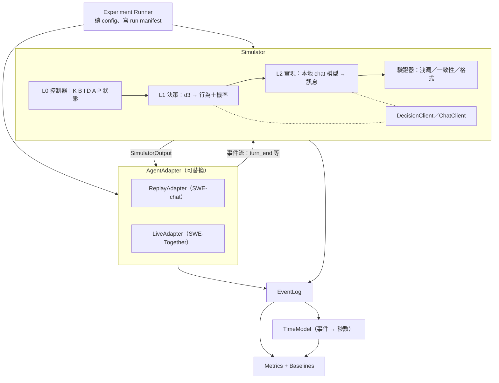

**調整側（離線）**

| 對象 | 調整內容 |
|---|---|
| L1 | few-shot 示例庫 → 機率修正 → 微調（遞進，前一階段無效才升級） |
| L2 | 選項 1 長度分布＋few-shot＋persona ／ 選項 2 LoRA 微調（可選：判別器對抗式延伸） |
| 評估用獨立判別器 | 只在評估時使用，不參與調整 |

### 1.2 介面契約

**Checkpoint**（replay 與 live 共用）

```json
{
  "checkpoint_id": "sess123#t17",
  "session_id": "sess123", "repo_id": "r9", "user_id": "u4", "agent": "Claude Code",
  "goal_card": {"objective": "...", "constraints": ["..."], "private_facts": [{"id": "F2", "holder": "privately_retrievable"}], "intervention_conditions": ["..."]},
  "prefix": "<至此為止的對話與工具軌跡，已做摘要與截斷>",
  "visibility_profile": "SWT",
  "agent_turn_type": "asks_question",
  "agent_turn_features": {"ends_with_question": true, "wrote_files": false, "test_failed": false, "diff_chars": 0},
  "real_action": {"behaviour": "correction", "message": "..."},
  "timing": {"user_latency_s": 41.0, "first_write_seen": false},
  "split": "train"
}
```

**SimulatorOutput**（每個 checkpoint 一筆）

```json
{
  "action": "message",
  "action_probs": {"no_op": 0.10, "non_pushback": 0.20, "correction": 0.60, "failure_report": 0.08, "rejection": 0.02},
  "facts_disclosed": ["F2"],
  "behaviour": "correction",
  "message": "用 UTC，在 deploy.yaml 裡。",
  "effort_inputs": {"msg_chars": 14, "artifacts_opened": [], "retrieval": false},
  "rationale": "僅供稽核，不傳給 agent"
}
```

**Event 類型**（v1 只啟用 `turn_end`，其餘預留）

| 事件 | 產生者 | 狀態 | 說明 |
|---|---|---|---|
| `turn_end` | agent／環境 | v1 啟用 | agent 回合結束 |
| `write_attempt` | agent／環境 | 預留 | agent 寫入前（opencode 是否提供 hook 待確認） |
| `plan_submitted` | agent／環境 | 預留 | 阻塞點：agent 會停下來等待，不需要真正打斷就能支援 |
| `permission_request` | agent／環境 | 預留 | 阻塞點：同上 |
| `inspect` | simulator 的動作 | v1.5，live 專用 | 唯讀 inspect 的記錄（見 §1.4） |
| `user_interrupt` | simulator 的動作 | v2 | 需要中途取消（見 §1.8） |

事件有兩種來源：agent／環境產生的事件，是「何時詢問 simulator」的觸發點，Config 以 `consult_on: [turn_end]` 選擇在哪些事件詢問；simulator 的動作（`inspect`、`user_interrupt`）則被記錄成事件，供記錄與重放。simulator 實際可選的動作是動作集（§2.2；live 中對應 SWE-Together 的五個決策工具）。§1.8 的 `tool_boundary` 同屬 agent／環境產生的事件。simulator 對阻塞點（`plan_submitted`、`permission_request`）的回應是既有動作（`approve`、`deny`、`redirect`），不新增事件類型；觸發點記在 checkpoint 的 `event_type`。

### 1.3 Simulator 分層

| 層級 | 實作 | 工作 |
|---|---|---|
| L0 | 規則與狀態控制器 | 動作資格遮罩、揭露規則、授權範圍、注意力預算、時間累計 |
| **L1** | **d3 decision model**（vLLM Semantic Router Decision 3.0） | 回答有型別的問題，回傳每個選項的機率：行為標籤、各事實是否此刻揭露。調整依 few-shot → 修改機率 → 微調遞進（§3.4） |
| **L2** | **本地 chat 模型** | 依 L1 結果與允許揭露的事實生成訊息。兩個選項待決定：1. 長度分布＋few-shot＋persona；2. LoRA 微調（§3.5） |
| L3（對照） | 單一本地 chat 模型端到端生成 | 對照「拆成 L1＋L2」是否真的有益 |

**單一 checkpoint 的處理流程**

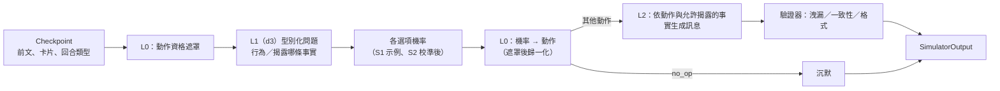

**為什麼 L1 用 d3**

| d3 的特性 | 對 L1 的好處 |
|---|---|
| 不生成文字，回答「選擇、是否、分數」並為每個選項回傳機率 | 機率直接成為 `action_probs`，不必抽樣估計或解析 JSON |
| 尺寸從 0.6B 到 27B，採 Apache-2.0 授權；一個問題只需要一次 forward pass | 成本低 |
| 可自架於 vLLM，也有託管的 Decision API（`POST /v1/systemone`） | 本地與 API 都能接 |

**d3 查證結果（2026-11-21，來自 model card 與 recipe 頁，尚未在我們的硬體上實測）**　✓ 已確認　△ 未確認

| 項目 | 狀態 | 內容 |
|---|---|---|
| 介面 | ✓ | `POST /v1/systemone`；題型 `choice`、`noul`（是否）、`score`；每請求最多 64 題，每個 `choice` 最多 255 個選項；回傳各選項機率；提示固定，不接受頂層 `instructions` |
| 上下文與成本 | ✓ | 建議 `--max-model-len 32768`；prefix caching 與 chunked prefill 關閉，成本隨「問題數 × 提示長度」成長 |
| 授權、尺寸與記憶體 | ✓ | Apache-2.0；27B、flash 9B、mini 4B、nano 2B、lite 0.8B、edge 0.6B；27B 峰值約 62–65 GiB（細節見附錄 D） |
| vLLM | ✓（未實際安裝測試） | 0.33.0 起支援（以 recipe 頁與 PyPI 為準，model card 的「需 nightly」已過時） |
| NVIDIA 路徑 | △ | 官方只在 AMD MI300X／MI325X 測試，CUDA 路徑未驗證；是第一個要驗證的風險（§3.1 關卡 F） |
| few-shot | △ | 文件未提在 state 中放示例，需實測 |
| 微調 | △ | 無訓練程式碼或 readout 說明，自行微調風險高；S3 預設改為「本地 chat 模型 LoRA 做 L1」，d3 微調列為高風險選項 |
| 小尺寸表現 | △ | d3-lite、edge 在本任務上的表現未知 |

### 1.4 觀察與工具權限（visibility profile）

simulator 要不要能主動查詢 agent 的動作或修改檔案？預設答案是：**不修改、不直接存取環境，只依 agent 回覆與一份受限的活動摘要決定下一步**。查詢能力以「有成本的唯讀 inspect」分階段加入。

| 層級 | 能力 | 時程 | 理由 |
|---|---|---|---|
| T0 被動觀察（預設） | agent 的回覆，加上依 visibility profile 提供的活動摘要 | v1 | replay 與 live 輸入一致，可與真人比較 |
| T1 唯讀 inspect | 從控制器提供的 artifact 清單（diff 區塊、測試輸出、檔案）選擇打開；每次打開記錄 `inspect` 事件，消耗 E 與 A | live 專用，v1.5 | 對應 A、R 與 RQ3 的「證據有限的維護者」 |
| T2 執行檢查 | 執行事先定義的重現或測試指令 | 後續 | 會改變環境狀態與時間成本；與 SWE-Together 的 check-external 動作相近 |
| 不做 | 修改檔案（協同編輯） | 後續擴充 | 見下方規則 7 |

**資訊流與邊界**

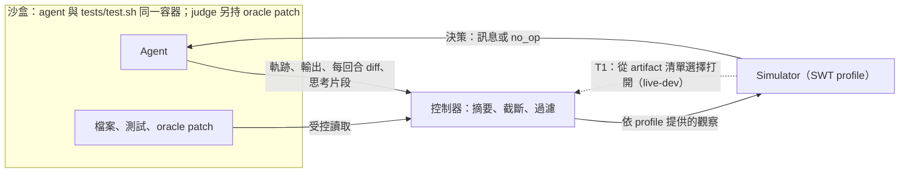

simulator 與 `FS` 之間沒有任何直接連線：這是規則 5 的圖示。

**visibility profile**

預設為 **SWT**，即與 SWE-Together 的 simulator 看到的資訊一致；P0–P3 保留，供日後消融。P0 ⊂ P1 ⊂ P2 ⊂ P3，逐級增加資訊。

| Profile | simulator 看得到 |
|---|---|
| **SWT（預設）** | 見下表 |
| P0 | 只有 agent 的回覆文字 |
| P1 | P0 ＋ 活動摘要（工具名稱、碰過的檔案、執行的指令、錯誤） |
| P2 | P1 ＋ diff 摘要（檔案與增刪行數） |
| P3 | P2 ＋ 完整 diff（設截斷上限） |

**SWT 的內容（依 `UserAgent.process()` 與 `_build_turn_summary`）**

| 項目 | SWE-Together 的做法 | 我們 replay 的對應 |
|---|---|---|
| 任務描述 | 只在第一次呼叫提供，截斷於 16,000 字元 | SWE-chat 的第一則使用者 prompt（或卡片中的目標） |
| 時間 | 已經過秒數與本回合耗時（實際牆鐘時間） | **差異**：agent 回合的耗時取自 timestamp；simulator 端的時間（打字、答覆等）由時間模型以事件估算，不用 simulator 的牆鐘時間 |
| 完成旗標 | `is_completion_attempt`：agent 宣稱完成時加一行提示 | 由回合特徵推論，定義需與 live 對齊 |
| agent 活動 | `recent_trajectory`，函式內不截斷 | 由 `tool_use`／`tool_result` 重建 |
| agent 輸出 | `latest_observation`，函式內不截斷 | agent 最後的回覆文字 |
| 程式碼變更 | `code_changes_diff`：每回合增量，由呼叫端 `UserEnabledClaudeCode._capture_git_diff` 產生；沙盒文件稱每回合 diff 上限 20 萬字元 | 由 Edit、Write 的工具輸入與檔案快照近似重建 |
| agent 思考 | `latest_analysis`，截斷於 300 字元 | SWE-chat 的 `assistant_thinking` 列，截斷於 300 字元 |
| 歷史 | 先前每回合的使用者訊息與 simulator 自己的決策（含理由） | replay 放真人實際說過的話（teacher-forced）；live 放 simulator 自己的決策 |
| 隱藏資訊 | system prompt 含 persona 與可選的 `session_analysis` | 隱藏狀態卡片 |
| 輸出 | 五個決策工具（no-op、question、redirect、new_requirement、check_external），`tool_choice` 為 required 或 auto，沒有工具呼叫就重試一次 | 結構化輸出；L1 改用 d3 時為型別化問題 |
| 停止 | `max_messages` 硬上限，達到後每個回合都變成 no-op | 同 |
| 環境存取 | 無；五個決策工具都不能讀檔、執行指令或檢查 repo；檔案內容、測試結果、指令輸出只有出現在軌跡、觀察或 diff 才會到達 simulator | 同 |

**與 SWE-Together 的一處刻意差異**：時間來源（agent 回合用 timestamp，simulator 端以事件估算，不用 simulator 的牆鐘）。其餘輸入（包含 agent 思考片段）與 SWE-Together 一致。

**規則**

| # | 規則 | 說明 |
|---|---|---|
| 1 | replay 與 live 使用同一個 profile | 否則兩個模式的結果不可比 |
| 2 | **agent 思考片段** | 與 SWE-Together 完全一致：提供並截斷於 300 字元，**不做消融**（replay 對應 SWE-chat 的 `assistant_thinking` 列）。限制：真實使用者的介面是否顯示它並不確定（無法確認使用者看到了什麼），結論註明這一點 |
| 3 | profile 是設計假設 | SWE-chat 沒有記錄真人實際看了什麼。暫不做消融，保持與 SWE-Together 一致，以利復現與比較 |
| 4 | replay 的 diff 與完成旗標只能近似 | 由工具輸入、檔案快照與回合特徵重建，不精確；增量 diff 或累積 diff 要明確定義（SWE-Together 的程式註解說每回合增量，沙盒文件說對 `harbor-base` tag 取 diff，兩者可能指不同的東西） |
| 5 | **不給 simulator 環境存取權** | SWE-Together 的沙盒中，任務的 `tests/test.sh` 與 agent 在同一個容器內，judge 另外持有 oracle patch。simulator 若能自由查詢環境，可能讀到隱藏測試或 reference patch。T1 的 artifact 清單由控制器過濾後提供 |
| 6 | **inspect 在 SWE-chat 無法驗證** | 沒有真人檢視的紀錄；replay 中 inspect 只能由已記錄的軌跡回應。T1 的擬真度只能在 pilot（RQ3）驗證 |
| 7 | **為什麼不做修改** | 真實使用者確實會自己改程式（SWE-chat 的 sessions 表有 `human_added`、`human_modified` 欄位），日後值得做；但 v1 不納入：SWE-Together 建構任務時排除了人類寫了大部分最終變更的 session，評分也假設變更由 agent 產生。simulator 若能改檔，任務就變成協同編輯，需要新的任務切分與評分 |
| 8 | **inspect 做成「從清單中選」，不是自由查詢** | 控制器列出可用 artifact 與各自的時間成本，simulator 決定打開哪些。這符合注意力有限的設定，也讓行為可記錄、可重放 |

### 1.5 模型與後端

| 角色 | 預設 | 備註 |
|---|---|---|
| L1 | d3 家族（lite 0.8B、nano 2B、mini 4B、flash 9B、d3 27B） | 經 DecisionClient；固定 revision；調整依 §3.4 的階梯 |
| L2 | 本地 chat 模型（約 7–8B 與約 30B 兩個級別各一） | 經 ChatClient（LiteLLM 指向 vLLM 等 OpenAI-compatible server）；選項 1 提示式，選項 2 LoRA（待決定） |
| 評估用判別器 | 一個獨立架構，在生成器凍結後才訓練 | **必做**，只用於評估；選型見 §3.5 |
| 訓練用／重排序用判別器 | 小型編碼器或小型 LM 加二元分類頭 | **可選**：只在 L2 選項 2b，或選項 1 的 best-of-n 重排序時使用；與評估用判別器架構與資料分開 |
| 匹配器、judge | 一個固定的強模型（可為 API），模型家族須不同於 L2 與 d3，版本固定 | 在真人與模擬訊息兩邊分別以人工標籤驗證；抽一個子集用另一家族的模型重判，主要結論若改變就註明；simulator 本身不依賴它 |
| API 模型 | 僅作參考基線 | 例如 chat 模型 L1、API 的 L2 |

| 實務設定 | 做法 |
|---|---|
| 微調框架 | LoRA／QLoRA（例如 PEFT、TRL），只在升級到微調時使用 |
| d3 服務 | vLLM 0.33.0 以上，建議 `--max-model-len 32768`；同卡同時跑多個服務時要調降 `--gpu-memory-utilization`（預設保留 92%）；記憶體估算見附錄 D |
| 快取 | 所有呼叫以「模型、版本或 revision、prompt hash、seed」為 key |
| 後端指標 | 解析失敗率、token 數、推論延遲都記為指標（延遲只供參考，不進時間模型） |

### 1.6 可迭代機制

| 機制 | 做法 |
|---|---|
| Run manifest | 每次實驗與每次訓練都寫一份 manifest，記錄資料切分版本、simulator config、模型 revision、LoRA 權重、判別器版本、prompt 版本、seed、程式碼 commit |
| 模型與校準 artifact 獨立存放 | 每個 backbone、每個訓練輪次各一份，不跨模型搬用 |
| 一次只改一個旋鈕 | 在 `CHANGELOG.md` 記錄改動與前後指標差異 |
| test 防護 | 存取 test 切分需 `--final` 旗標，且每次存取寫入日誌；凍結後的 test 評估只跑一次 |
| 凍結標籤 | `v1-candidate`、`v1-frozen`；凍結後 simulator、判別器、評分規則都不再變動 |

### 1.7 建議目錄結構

```
simulator/
  configs/   data/{raw,processed,splits}/   docs/   runs/   CHANGELOG.md
  models/    # 示例庫索引、長度與風格統計、校準 artifact、（若有）LoRA 權重（含版本）
  src/{llm, schemas, data, sim, stages, disc, adapters, eval}/
```

### 1.8 中途打斷的擴充路徑

**現行回合制能否支援？** 介面層可以，行為層不行：事件、config、checkpoint 欄位都已預留，不必改架構；但 simulator 只在 `turn_end` 被詢問，agent 工作到一半時沒有任何詢問點，所以要新增詢問點才能做到真正的打斷。

| 能力 | 現行回合制（只在 `turn_end` 詢問） | 需要新增什麼 |
|---|---|---|
| 阻塞點事件（計畫提交、權限請求） | ✓ 可：agent 自己停下來等待，simulator 在該事件被詢問 | 事件 hook（opencode 是否提供待確認） |
| 排隊式插話：agent 工作中輸入，待目前工具呼叫完成後送達 | ✗ 不可：agent 工作中沒有詢問點 | 回合內的詢問點（工具邊界）、`inject(queue)` |
| 硬打斷：取消目前動作並重導 | ✗ 不可 | harness 的取消與續跑、`cancel()`、事件時間軸 |

**真實 client 的行為（設計依據；各 client 與版本不一，需在資料與 harness 中確認）**：Claude Code 在 agent 工作時輸入的訊息預設排隊，工具呼叫完成後於同一回合送達；Esc 為硬打斷，已完成的工作保留。桌面 app 等版本的行為不同（來源見附錄 C）。SWE-chat 的 `queue_operation` 記錄排隊訊息（`user_prompt_enqueued`、`user_prompt_delivered`、`user_prompt_discarded`），是排隊式插話的基線；硬打斷沒有專屬欄位，需從原始轉錄確認其記錄形式。

**打斷發生時的流程**

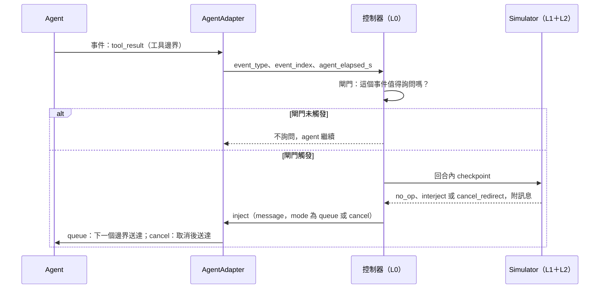

**路線圖**

| 階段 | 能力 | 詢問點 | 需要的改動 | 驗證方式 |
|---|---|---|---|---|
| v1（現行） | 回合結束時回應 | `turn_end` | — | 階段 2、3 |
| v1.5（與 T1 同期，可選） | 阻塞點事件、唯讀 inspect | `plan_submitted`、`permission_request`；inspect（live） | 事件 hook；artifact 清單 | pilot（SWE-chat 沒有對應資料） |
| v2a | 排隊式插話 | 工具邊界，經閘門 | 回合內 checkpoint；`inject(queue)`；動作集加入 `interject` | replay：以 `queue_operation` 校準；live：效果 |
| v2b | 硬打斷 | 工具邊界，經閘門 | harness 取消與續跑；`cancel()`；動作集加入 `cancel_redirect` | live-dev；確認 agent 已完成的工作是否保留 |

**現在就要做的預留**

| # | 預留項目 | 原因 |
|---|---|---|
| 1 | checkpoint 增加 `event_type`、`event_index`、`agent_elapsed_s`（v1 固定為 `turn_end`） | 回合內 checkpoint 不必改 schema |
| 2 | 動作集預留 `interject`、`cancel_redirect`（v1 以資格遮罩關閉） | 不改 L1 的問題結構 |
| 3 | AgentAdapter 介面預留 `events()`、`respond(event, decision)`（回覆阻塞點）、`inject(message, mode)`、`cancel()`（v1 只實作回合結束） | replay 與 live 共用同一介面 |
| 4 | config 預留 `consult_on: [turn_end, tool_boundary]` 與 `gate` | 詢問點與閘門由設定決定 |
| 5 | 時間模型當作事件時鐘：simulator 在事件時刻 t（取自 agent 的 timestamp）決定，打字時間由時間模型給，訊息在 t 加打字時間之後的第一個邊界送達；agent 回合若先結束，就退化成一般回合訊息 | 與排隊語意一致，且不使用 simulator 的 wall-clock |
| 6 | 階段 1 就從 `queue_operation` 抽出基線（已在 §2.3） | 先知道真人插話的頻率與時機 |

**成本控制與評估**：詢問點增加後，d3 的計算量（附錄 D 的公式）會成倍增加，所以先用閘門判斷「這個事件值得詢問嗎」，觸發才跑完整 L1；閘門可用 L0 規則（錯誤、測試失敗、重複編輯、長時間無輸出、首次寫入、diff 超過門檻）或 d3-lite 的單一 `noul` 問題。評估看介入率與時機（按 agent 活動類型分層）、邊界層級的 AUPRC 與校準、排隊與硬打斷的比例；live-dev 另看對 agent 結果的影響與過度打斷率。

**限制與風險**：teacher-forced 的軌跡在真人打斷之後已經分岔，replay 只能使用真實軌跡，沒有反事實；SWE-chat 對硬打斷的紀錄可能不完整；不同 agent 與 client 的排隊語意不同；harness 能否注入訊息與取消 agent 尚未驗證（§6）。

---

## 2. 階段 1：資料準備

### 2.1 取得資料

| 資料 | 來源 | 存取與授權 | 使用方式 |
|---|---|---|---|
| SWE-chat | Hugging Face `SALT-NLP/SWE-chat` | 需登入並接受存取條件；授權 odc-by | 使用 `conversations`、`sessions`、`session_logs` 表；需要完整內容時讀 `transcript_path` 指向的原始 jsonl（conversations 表中工具結果被截斷在 10KB）；固定下載版本並記錄（資料集持續增長） |
| SWE-Together | Hugging Face `yfwu/SWE-Together`（109 個任務）與 GitHub repo | 程式碼 Apache-2.0 | 先在 3–5 個任務上復現其流程，確認 simulator 介面、user-sim prompt 與評分腳本 |

### 2.2 行為標籤（v1）

v1 **不做 tagger，也不做 K/D/I/C 編碼**（移到 §6 後續擴充）。階段 2 與 3 只比較**行為分布**。

| 項目 | 內容 |
|---|---|
| 標籤集 | `no_op`, `non_pushback`, `correction`, `failure_report`, `rejection` |
| 真人側來源 | `no_op` 由機械規則判定（使用者沒有發訊息）；其餘四類直接用 SWE-chat 自帶的 `prompt_pushback` 標籤 |
| 無標籤訊息 | 資料集沒有標籤者記為 `unlabeled`，單獨列出，不猜測 |
| simulator 側來源 | 由 L1 直接選出標籤（`action_probs` 即在此標籤集上） |
| 清理 | harness 寫入的列（中斷標記、斜線指令、只有圖片的列、自動審核 session）不是使用者行為，一律移除 |
| 已知限制 | 資料集標籤由 LLM 產生，我們未驗證；simulator 的標籤是自我宣告，沒有檢查訊息是否與標籤一致；未量測標註者一致性 |

### 2.3 建立回合資料庫

| 項目 | 內容 |
|---|---|
| Checkpoint 定義 | 每個 agent 回合結束後設一個 checkpoint，真實動作為「下一則使用者訊息」或「沉默（no_op）」。**必須包含沉默的 checkpoint**，否則無法量測 simulator 多話的問題 |
| 回合邊界 | 由 `conversations` 表的 `user_prompt`、`assistant_response`、`tool_use`、`tool_result` 列推得 |
| `queue_operation` | 單獨記錄（agent 忙碌時輸入的訊息），作為日後打斷行為的基線（§1.8） |
| 每個 checkpoint 記錄 | 前文（摘要與截斷）、agent 回合類型與特徵、真實動作與行為標籤、使用者延遲、是否已出現首次寫入 |
| 前文看不到未來 | 這是洩漏檢查的第一道關 |

### 2.4 隱藏狀態卡片（goal card）——few-shot 示例與微調都需要

simulator 在新任務上要依「使用者知道什麼、想要什麼」行動，所以示例與訓練資料也要有同樣的輸入。SWE-chat 沒有這些標註，需要為每個 session 建一張卡片。

| 項目 | 內容 |
|---|---|
| 卡片內容 | 目標、限制、使用者私下知道的事實（附持有者與取得路徑）、介入條件 |
| 產生方式 | 以**本地模型**（端點與模型在 `.env` 設定）由整個 session 重建（做法參考 SWE-Together 的 session analysis），**禁止逐字複製後續使用者訊息** |
| 洩漏稽核 | 比對卡片與後續訊息的 n-gram 重疊，抽樣人工複核 |
| 已知風險 | 卡片由事後觀點產生，模型可能學到「照卡片做」的捷徑；訓練時的卡片（LLM 重建）與測試時的卡片（authored fixture、SWE-Together 的 session analysis）分布不同 |
| 因應 | 做「有卡片」與「只有歷史」兩種條件的消融；面向 B 的結論註明是在卡片條件下取得 |
| SWE-Together 的 48 個任務 | 直接使用其既有的 session analysis，不重建 |
| 對齊 SWE-Together | SWE-chat 的卡片以與 session analysis 相同的欄位與生成方式重建（若其提示詞與格式未公開，則依其輸出欄位設計並盡量對齊），縮小訓練與測試卡片的分布差距；對齊程度只比較欄位層級統計（長度、事實數量），不用 48 個重疊任務調整提示詞（§2.7） |

### 2.5 示例庫與訓練資料

| 用途 | 內容 | 來源與備註 |
|---|---|---|
| L1 few-shot 示例庫（S1） | 真實 checkpoint：state、真實動作、行為標籤 | 取自 **train**；以回合類型與狀態相似度檢索；標籤來自資料集，有雜訊 |
| L1 校準集（S2） | 同上，用於擬合溫度、每類偏置、疊接校準器 | 取自 **dev**，與示例庫不重疊 |
| L1 微調資料（S3，僅升級時） | state ＋ 型別化問題 → 真實標籤 | 取自 train；no_op 偏多，需加權或平衡抽樣；訓練用資料集標籤，dev／test 的評估標籤另有人工驗證子集 |
| L2 長度與風格統計（選項 1） | 訊息長度分布（條件在動作與回合類型）、風格特徵 | 取自 train；只用非 no_op 的 checkpoint |
| L2 few-shot 示例庫（選項 1） | 真實訊息，附 state 與動作 | 取自 train；以動作、回合類型與相似度檢索；依 persona 分組 |
| persona 標籤（選項 1） | SWE-chat 的 `user_persona`（Expert Nitpicker、Vague Requester、Mind Changer、Other） | 由 LLM 標註，可靠度需抽樣確認 |
| L2 LoRA 資料（選項 2，若採用） | state ＋ 真實動作 ＋ 允許揭露的事實 → 真實訊息 | 取自 train；清除系統注入文字、中斷標記等殘留，去重 |
| 判別器資料 | （state、動作、訊息）→ 真實或生成 | 評估用必做，訓練／重排序用可選；負樣本由 L2 在同一 state 與真實動作下生成 |

資料處理注意：使用者訊息可能含人名、路徑、金鑰等敏感內容。示例庫會把真實訊息放進提示，微調模型則有記憶風險；兩者都需要匿名化與去重，並記錄授權（odc-by）與使用範圍。

### 2.6 agent 回合類型（分層）

由工具呼叫與回應機械判定的少數類型，用來在比較時消除 agent 組成差異。

| 項目 | 內容 |
|---|---|
| 類型範例 | 回合結尾提問、宣稱完成、報錯或受阻、提交計畫、大型修改、一般進度 |
| 檢查 | 每個類型的樣本量；樣本過少者合併 |
| 標示 | 標明「無校準資料」的類型 |

### 2.7 切分

| 項目 | 規則 |
|---|---|
| 切分單位 | 按**開發者與 repo** 切 train／dev／test，同一開發者與同一 repo 不跨切分 |
| 各切分用途 | train：示例庫與（若微調）訓練；dev：校準、選擇 shot 數與早停；test：只在凍結後跑一次 |
| 排除 | SWE-Together 中來自 SWE-chat 的 48 個任務對應的 session：不進 train、dev、test，只用於面向 A |
| 48 個重疊任務的用法 | 不用於任何調整（示例庫、校準、微調、選項決策、早停）。依 §4.2 的 live-dev／live-test 切分（replay 與 live 共用同一切分）：Phase 2 只在 live-dev 上監看面向 A 的指標，不據此做選擇；live-test 在凍結後只跑一次；live 階段的調整限制見 §4.4 |
| leave-one-agent-out | 預先製作折（需先統計各 agent 的 session 數）。示例庫與校準可按折重建，成本低；若升級到微調，每一折都要重新訓練，首版只對 L1 做 |
| 凍結 | 切分在階段 1 結束時凍結並版本化 |

### 2.8 SWE-Together 任務對應

| 項目 | 內容 |
|---|---|
| 對應表 | 建立 48 個任務與 SWE-chat session 的對應（需確認任務中保存的 session 識別資訊） |
| gold | 對每個任務把原始使用者訊息拆成 **atomic intents**，並標註動作類型、觸發條件與出現位置，作為面向 A 的 gold |
| 不納入 | 其他來源的任務（DataClaw、Pi-staging、Hyperswitch）格式不同，首版不納入 |

### 2.9 基線與雜訊下界

| 項目 | 內容 |
|---|---|
| 基線 | 一律 no_op、依經驗頻率抽樣（按回合類型）、persona-only 的 LLM、d3 零樣本、本地 chat 模型提示式 |
| **real-vs-real 下界（分布）** | 把真實資料按開發者切成兩半，計算兩半之間的分布差距 |
| **real-vs-real 下界（判別器）** | 訓練一個判別器分辨「不同開發者的真實訊息」，其準確度是判別器評估的下界參考 |

### 2.10 時間模型 v0

| 項目 | 內容 |
|---|---|
| agent 回合耗時 | 直接取自 SWE-chat 的 timestamp（live 為實際執行時間），不估算 |
| 形式 | 以事件為輸入、秒數為輸出的純函數，只用於 simulator 端 |
| simulator 端的答覆與打字時間 | 由真實使用者延遲校準，使用中位數與截尾處理（延遲包含閒置） |
| 檢索證據、審查 patch | 無法從轉錄觀察，先留空，待 pilot 校準 |

### 2.11 交付物與通過條件

| 交付物 | 通過條件（數值門檻事先設定） |
|---|---|
| 行為標籤 | 已移除 harness 寫入的列；回報標籤覆蓋率與無標籤比例 |
| 回合資料庫與切分 | 無開發者與 repo 洩漏；48 個重疊任務已排除；各回合類型樣本量已盤點 |
| 隱藏狀態卡片 | 洩漏稽核通過；抽樣複核合格 |
| 示例庫與訓練資料 | 標籤品質已量化；清洗與匿名化完成；示例庫只來自 train |
| SWE-Together 任務對應與 gold | 對應表完整；atomic intents 經抽樣複核 |
| 基線與下界 | 基線與 real-vs-real 下界已計算 |
| 復現檢查 | 3–5 個任務可在原 pipeline 跑通 |

---

## 3. 階段 2：replay 模式與 simulator 調整

### 3.1 起點與關卡

d3 的查證結果見 §1.3。

| 關卡 | 要回答的問題 | 做法與現況 | 結果決定什麼 |
|---|---|---|---|
| **基線（S0）** | 起點在哪裡 | d3 各尺寸零樣本做 L1；本地 chat 模型提示式做 L2（不含長度分布、few-shot、persona）。在 dev 上與 §2.9 的基線一併比較 | 後續各階段的比較基準 |
| **A** | d3 能否有效利用 few-shot 示例 | 官方文件沒有提到在 state 中放示例，需實測 | 若無可測量的效果，L1 直接進入 S2 |
| **B** | 上下文長度是否夠用 | 已確認可用（建議 32,768）。仍要在 32k 下實測延遲與記憶體，並以摘要把提示控制得較短，因為 prefix caching 關閉、每個問題都要重算整個提示 | 提示摘要策略 |
| **C** | 能否微調 d3 | 文件沒有訓練程式碼或做法；d3 微調需自行實作，且 readout 機制未文件化，列為高風險選項 | S3 預設走「本地 chat 模型 LoRA 微調做 L1」 |
| **D** | L2 用哪個選項 | 見 §3.5 的決策關卡 | L2 的路線 |
| **E** | visibility 是否消融 | **暫緩**，目前固定為 SWT | — |
| **F** | d3 在 NVIDIA 上能否運作 | 官方測試在 AMD MI300X／MI325X，明說 CUDA 路徑未在 NVIDIA 上跑過。在 A100 與 H200 上以 vLLM 0.33.0 以上實測 d3 各尺寸：能否啟動、與 AutoModel 的結果是否一致（官方在 MI300X 上 416 題中 415 題一致，可作為參照）、延遲與記憶體 | 能否在我們的 GPU 上使用 d3 |

### 3.2 teacher-forced 評估協議

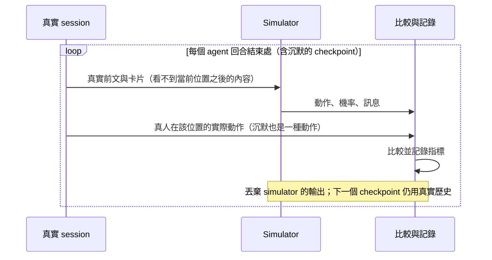

simulator 記憶放真人實際說過的話。結果解讀為單步擬真度的**上界**，不用來預測 live 表現。

### 3.3 指標

| 層／面向 | 指標 | 做法與比較對象 |
|---|---|---|
| 動作層（L1） | log loss、Brier score、macro-F1 與每類準確率、校準誤差（ECE）、每個回合類型內的 forward／backward KL | 與基線比較 |
| 分布比較（面向 B） | 每個回合類型內行為分布；JS 或 TV 距離 | 對真人與 simulator 各自計算，以固定權重（例如 test 集各類型的比例）加總，消除 agent 組成差異；以開發者為單位做 bootstrap 信賴區間 |
| 分布比較（面向 B） | 每個 session 或每位開發者的比率分布（含離散程度） | 除了池化後的分布，也要比較 |
| 條件行為 | 例如 P(correction ｜ agent 宣稱完成)；P(發訊息 ｜ 首次寫入前) | 真人與 simulator 比較 |
| 語言層（L2）：判別器 | **評估用判別器的準確度與 AUC**（見 §3.5） | 與 real-vs-real（不同開發者）的下界比較 |
| 語言層（L2）：一致性 | 暫緩：需要 tagger（§6） | — |
| 語言層（L2）：洩漏率 | — | — |
| 語言層（L2）：風格分布 | 訊息長度、簡短交易式比例、客套用語、路徑與程式碼引用、疑問句比例 | 與真實分布比較 |
| 語言層（L2）：多樣性 | distinct-n、同一情境多次取樣的差異、長度分布的離散程度 | 防止模式崩塌 |
| 語言層（L2）：人／LLM 評審 | 真實性評審 | 只做偶爾稽核（SWE-Together 的 Turing 通過率僅 46%，不適合作為主要依據） |
| 單任務 coverage（面向 A，48 個任務） | Intent recall／precision | gold intent 是否在對應位置（容許小的位置視窗）被 simulator 表達；非 no_op 的訊息有多少落在某個 gold intent 內 |
| 單任務 coverage（面向 A） | Action-type recall／precision；時機對齊 | — |
| 單任務 coverage（面向 A） | 匹配方式 | 用固定的強模型，並以人工標籤抽樣驗證 |

語言層（L2）以**真實動作作為輸入（oracle action）**單獨評估。Intent Coverage 與分布差距的公式、平滑與信賴區間做法見附錄 E。面向 A 的數字在 Phase 2 只作監看，不據此做選擇（§2.7）。

### 3.4 L1 遞進式調整

| 階段 | 做什麼 | 資料 |
|---|---|---|
| S0 零樣本 | d3 直接回答型別化問題（基線） | — |
| S1 few-shot | 在 state 中放入檢索到的真實示例 | 示例庫（train） |
| S2 修改機率 | 事後校準：按回合類型學溫度與每類偏置；對經驗頻率做 prior 重新加權；必要時用疊接校準器（例如 logistic regression）整合 d3 的選項機率與回合類型特徵 | 校準集（dev） |
| S3 微調 | 以真實標籤微調 d3（若可行），否則以本地 chat 模型 LoRA 微調做 L1 | 微調資料（train），dev 早停 |

**遞進規則（待確認）**

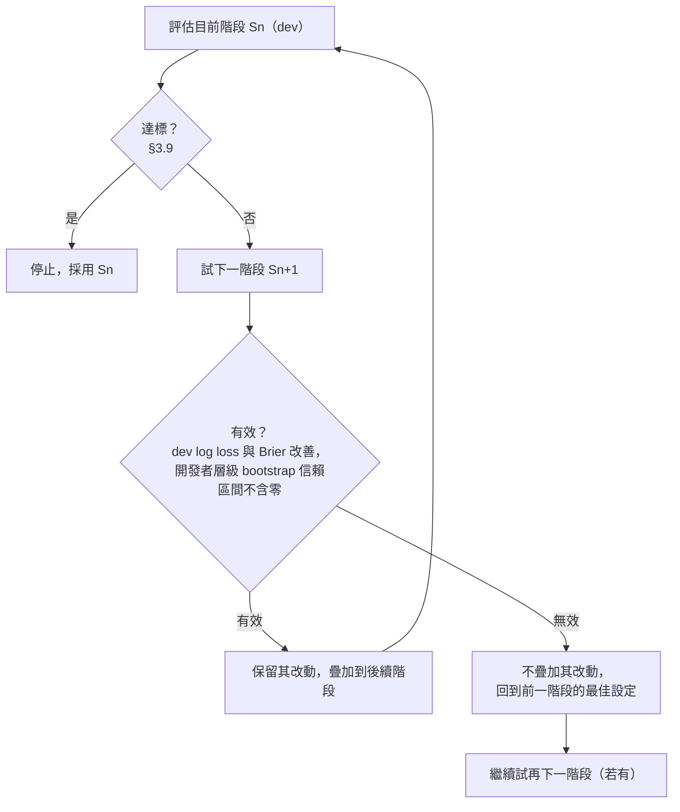

每個階段用相同指標報告，形成階梯表，同時就是消融。

**各階段細節**

| 階段 | 細節 |
|---|---|
| S1 | 示例選擇：同回合類型與相似狀態；shot 數 k 在 dev 上選，受 d3 上下文長度限制。示例的類別比例：自然頻率（保留先驗，no_op 佔多數）與類別平衡兩種都試；平衡取樣會把預測推離真實先驗，之後需要 S2 校正 |
| S2 | 按回合類型分別擬合；樣本少的類型合併或標示「無校準資料」。校準參數屬於各 backbone 與各尺寸，不跨模型搬用。動作資格遮罩（L0）加在輸出機率上並重新歸一化 |
| S3 | 階層式問題：先問行為；只有行為相關時才問「揭露哪條事實」。損失用交叉熵；類別加權或平衡抽樣處理 no_op 偏多；按回合類型分層取樣；dev 早停。標籤雜訊用人工驗證子集估計其影響 |
| 尺寸 | 從 d3-mini 起，向上或向下比較，找出「夠用的最小尺寸」 |

### 3.5 L2：兩個選項（待決定）

**目的**：在動作與事實已由 L1／L0 決定的前提下，讓生成的訊息在語言上接近真人，同時不違反約束。

#### 選項 1：長度分布＋few-shot＋persona（不更新權重）

| 元件 | 做法 |
|---|---|
| 長度 | 從 train 估計「動作 × 回合類型」條件下的訊息長度分布；每次生成前抽一個目標長度，放進提示或作為上限。評估時比較生成與真實長度分布（例如 KS 距離） |
| few-shot | 檢索同動作、同回合類型、狀態相似的真實訊息（來自 train） |
| persona | 以 `user_persona` 分組，使用該 persona 專屬的示例與長度分布。族群匹配模式下依經驗分布抽 persona，受控模式下固定。persona 是 session 層級、由 LLM 產生的標註，需先抽樣確認可靠度 |
| 選用：重排序 | 取樣 n 個候選，用便宜的風格與一致性評分器重排序。若用判別器重排序，必須與評估用判別器分開 |

#### 選項 2：LoRA 微調（待決定是否採用）

| 子選項 | 內容 |
|---|---|
| **2a SFT** | 以 LoRA 微調「(state、動作、允許事實) → 真實訊息」，同時作為參考模型 |
| **2b 對抗式延伸（可選）** | 訓練判別器分辨真實與生成訊息，並以它的訊號迭代更新 L2 |

**2b 的對抗式迴圈**

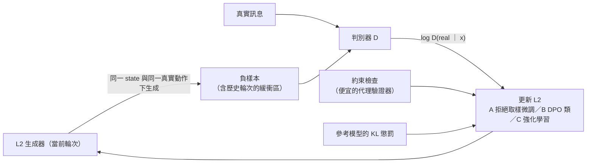

**判別器設計（2b）**

| 項目 | 做法 |
|---|---|
| 輸入與輸出 | 輸入（state、真實動作、訊息），輸出真實的機率；負樣本由當前 L2 在**同一 state 與同一真實動作**下生成，所以它只學語言差異 |
| 成對判別器（可選） | 同一情境給兩則訊息，判斷哪一則是真人寫的，較省樣本，也較不受長度捷徑影響 |
| 負樣本緩衝區 | 保留歷史輪次生成的負樣本，避免判別器只針對最新生成器、造成來回震盪 |

**更新 L2 的方式（由穩定到不穩定，建議依序嘗試）**

| 方式 | 做法 | 特點 |
|---|---|---|
| A. 拒絕取樣微調 | 每個情境取 n 個候選，保留判別器評分最高且通過約束的，做 SFT | 最穩定，實作簡單 |
| B. 偏好式（DPO 類） | 以真實訊息為 chosen、模型自己的生成為 rejected 做偏好微調；類似自我博弈微調的做法 | 不需要線上 RL，仍保留對抗意涵 |
| C. 強化學習 | 以判別器分數為獎勵，加上對參考模型的 KL 懲罰（PPO、GRPO 類） | 效果可能最強，但不穩定、資源需求高 |

獎勵形式（C，或用於 A 的排序）：`reward = log D(real | x) − β·KL(π ‖ π_ref) − λ·1[違反約束]`。訓練時的約束檢查使用便宜的代理驗證器（規則式洩漏檢查、小型分類器）；

**防護（2b）**

| 風險 | 對策 |
|---|---|
| 生成器鑽判別器的漏洞（例如刻意打錯字、變短） | KL 懲罰；判別器集成或定期重新初始化；檢查生成的長度與格式分布 |
| 判別器靠捷徑（長度、格式、資料清洗殘留） | 清洗資料；負樣本以長度分布匹配；做特徵消融；成對判別器 |
| 模式崩塌 | 追蹤多樣性指標；KL 懲罰；每輪保留 SFT 參考 |
| 循環論證：用同一個判別器訓練又評估 | 評估用判別器使用不同架構、在生成器凍結後才訓練、以 train 資料訓練並在 test 上評估 |
| 判別器只管擬真，不管資訊正確 | 約束檢查作為硬性過濾與獎勵項；一致性與洩漏仍是獨立的通過條件 |
| 準確度接近 50% 不代表真的像 | 以獨立判別器、風格分布與小規模人工稽核交叉確認 |
| 判別器準確度很難降到 50%（不同開發者本來就有個人風格） | 以不同開發者真實訊息之間的準確度作為合理下界，不以 50% 為目標 |

對抗式訓練本身不穩定，以上是設計方案，尚未在本任務上驗證；停止準則為 dev 上獨立判別器的準確度與風格分布不再改善，或多樣性、一致性開始惡化，最大輪數由小規模試跑決定。

#### 判別器模型選型

評估用判別器（必做）與訓練／重排序用判別器（可選）各自選型；模型名稱是候選，最終依 dev 上的實測決定，並在實作時確認可用的最新版本。

| 角色 | 候選 | 為什麼選它 | 限制 |
|---|---|---|---|
| 評估用 A（主） | 微調編碼器：DeBERTa-v3（base 約 184M，large 約 400M） | 控制實驗（相同預訓練資料）顯示 DeBERTa-v3 的整體表現與樣本效率優於 ModernBERT（檢索任務例外）；在另一個 GitHub repo 分類研究中 DeBERTa-v3-base 優於 ModernBERT-large。我們的資料量有限，樣本效率重要 | 輸入長度有限，state 需壓縮成短摘要；訊息本身通常很短 |
| 評估用 B | ModernBERT-base（約 139M） | 訓練與推論較快，原生支援較長上下文；預訓練與架構不同於 DeBERTa，提供不同家族的交叉檢驗 | 同資料下樣本效率不一定勝過 DeBERTa-v3 |
| 評估用 C | 表面特徵與 n-gram（TF-IDF）加 logistic regression 或梯度提升樹 | 透明，能直接看出捷徑（長度、標點、大小寫、路徑與程式碼片段比例、是否為問句）；也是判別器的基線 | 抓不到語意層的差異 |
| 評估用 D（可選） | LLM 加 LoRA 分類頭（約 1–8B），模型家族須不同於 L2 | 能處理較長的 state；可能是最強的偵測器，給出最緊的下界 | 成本較高；與 L2 同家族會失去獨立性 |
| 輔助 | 凍結的 embedding 加線性探針 | 輕量，適合當分布層級診斷（見下） | 看不到風格；不可單獨作為判別器 |
| 訓練／重排序用（可選） | 小型編碼器（例如 MiniLM、DistilRoBERTa 級，或 ModernBERT-base） | 便宜、可快速重訓；2b 可用成對版本 | 必須與評估用判別器架構、資料子集與 seed 都分開 |

| 使用規則 | 說明 |
|---|---|
| 主要報告值 | 取準確度最高的評估用判別器（它給出最緊的下界），其他作診斷 |
| 輸入變體 | 三種都做：只有訊息文字（測風格）、訊息＋動作、訊息＋動作＋壓縮 state（測一致性） |
| 訓練設定 | 負樣本以長度分布匹配；多個 seed、報告信賴區間；與 §2.9 的不同開發者下界對照 |
| 獨立性 | 評估用判別器在生成器凍結後才訓練，以 train 訓練、test 評估；任何用於訓練或重排序的判別器都不得沿用同一個模型 |
| 選定方式 | 以「不同開發者的真實訊息對」作為基準任務，在 dev 上比較各候選，不事先決定 |

**embedding 相似度的角色**：不單獨當判別器（會抹掉長度、標點、錯字等真人風格），只用於分布層級比較（MMD、Fréchet 距離）、多樣性、記憶化最近鄰檢查與輕量線性探針。

**現成偵測器基線**：沒有找到專為「真人 vs 模擬使用者訊息」訓練的預訓練判別器，所以評估用判別器仍要自行訓練。零樣本偵測器（Binoculars、Fast-DetectGPT）與預訓練的監督式偵測器可作補充基線，但在短文本與領域外都不穩：AUC 高是有力的負面證據，AUC 低則沒有資訊。商用 API 因隱私不使用；詞彙多樣性指標（MATTR、HD-D、Yule's K）納入 §3.3 的風格分布。

#### 決策關卡（待決定）

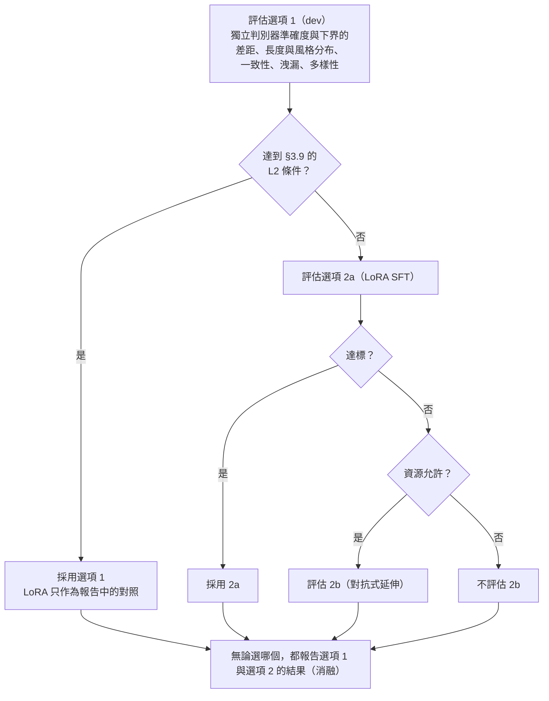

選擇依據事先登記：

| 依據 | 說明 |
|---|---|
| 達標與否 | 是否達到 §3.9 的 L2 條件 |
| 與選項 1 的差距 | 是否超出雜訊 |
| 成本 | 訓練與推論成本 |
| 風險 | 微調帶來的隱私與記憶風險 |

### 3.6 診斷流程

在 dev 上按 agent 回合類型看行為分布，定位是哪一層出問題：

| 症狀 | 最可能的層 | 調整什麼 |
|---|---|---|
| `no_op` 太多或太少 | L1 | 按回合類型校準；訓練資料平衡 |
| `correction` / `failure_report` / `rejection` 比例不對 | L1 | 該回合類型的校準 |
| 標籤對但訊息不像真人 | L2 | 長度模型、示例庫或訓練資料 |

### 3.7 模型比較實驗

| 因子 | 水準 |
|---|---|
| L1 階段 | S0 零樣本／S1 few-shot／S2 修改機率／S3 微調（依遞進規則，未升級者不跑） |
| d3 尺寸 | lite、nano、mini、flash、27B（從 mini 起，向上或向下比較） |
| L1 對照 | 基線；本地 chat 模型提示式 L1 |
| L2 選項 | 選項 1（長度分布＋few-shot＋persona）／選項 2a（LoRA）／選項 2b（對抗式延伸，可選） |
| L2 模型 | 本地約 7–8B 與約 30B 級 |
| 結構 | L1＋L2（拆開）vs. L3（單一模型） |
| 卡片條件 | 有卡片 vs. 只有歷史 |
| visibility profile | 預設 SWT（與 SWE-Together 一致）；P0–P3 消融暫緩，之後再做，「時間來源」列為獨立因子；agent 思考片段與 SWE-Together 一致，不做消融 |
| 參考 | 一至兩個 API 模型（僅作上限參考） |

規模不一定單調（Mehri et al. 發現 Llama-3.1-8B 在 coding 上優於 Llama-3.3-70B），每個級別都要測。

「本地小模型夠用」的事先定義：解析成功率（L2）、動作準確率、intent recall／precision、與真人分布的距離、獨立判別器準確度、洩漏率，在雜訊範圍內接近 API 參照，且明顯優於經驗頻率基線。

### 3.8 迭代規則

| 規則 | 內容 |
|---|---|
| 資料使用 | 所有調整只用 train／dev：S1 的示例庫來自 train，S2 的校準來自 dev，兩者不重疊 |
| 48 個重疊任務 | 不用於調整決策；Phase 2 只在 live-dev 上監看面向 A，live-test 凍結後只跑一次（§2.7） |
| 流程 | 一次一個旋鈕；每次寫 manifest 與 changelog |
| 升級與選擇 | L1 依 §3.4 的遞進規則升級；L2 依 §3.5 的決策關卡選擇 |
| 報告 | 每個階段都同時報告基線與 real-vs-real 下界 |
| 變異 | 訓練類的結果（微調、2b）多個 seed，報告變異 |
| 停止準則 | 連續幾輪調整在 dev 上的改善小於雜訊；或達到 §3.9 的條件 |

### 3.9 進入階段 3 的條件（門檻數值事先設定）

| 條件 | 說明 |
|---|---|
| 動作層優於經驗頻率基線 | log loss 與 Brier，信賴區間不含零 |
| 每個回合類型內的分布差距接近 real-vs-real 下界 | 容許差距事先設定 |
| L2：獨立判別器準確度接近下界，且一致性、洩漏、多樣性達標 | 不只看判別器 |
| 洩漏率與解析失敗率低於門檻 | 洩漏目標為零 |
| 標明哪些回合類型「無校準資料」 | 不硬報告擬真度 |
| 產出 `v1-candidate` | 附示例庫版本、校準 artifact、（若有）模型權重與 manifest |

---

## 4. 階段 3：live 驗證

### 4.1 改造 SWE-Together 的 live harness

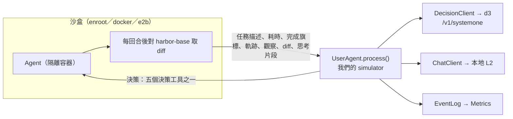

| 項目 | 做法 | 狀態 |
|---|---|---|
| 替換 user simulator | 介面是 `UserAgent.process()`，呼叫端傳入任務描述、耗時、完成旗標、軌跡、觀察、diff 與思考片段；simulator 輸出五個決策工具之一，並受 `max_messages` 上限約束。diff 由呼叫端（`UserEnabledClaudeCode._capture_git_diff`）產生，不在該檔案內。我們的 simulator 要實作相同的呼叫介面 | 模型呼叫走 LiteLLM，是否能指向自己的端點需實測 |
| 模型服務 | L1 走 DecisionClient（`/v1/systemone`），L2 走 ChatClient；兩者都在本地 server | SWE-Together 官方文件的 vLLM 後端僅支援 agent seat，user simulator 走 LiteLLM，需要實測能否接入自己的端點 |
| 沙盒設計 | 沿用：agent 在隔離容器內執行，每回合後對 `harbor-base` 取 diff，每個 agent 回合上限 1800 秒、整個 trial 上限 5400 秒，交給模擬使用者的每回合 diff 上限 20 萬字元 | — |
| 沙盒後端 | enroot 具強制的網路管控，可用於 leaderboard；docker 與 e2b 為全開或全關，僅供開發 | — |
| 事件 hook | v1 只啟用 `turn_end`；預留 `write_attempt`、`plan_submitted`、`permission_request` | opencode 是否提供權限或寫入前 hook 待確認 |
| AgentAdapter | 以 AgentAdapter 抽象，使 replay 與 live 共用同一個 simulator與事件記錄 | — |
| 唯讀 inspect（T1） | 只在 live-dev 上作為獨立實驗開啟（§1.4）；artifact 清單由控制器過濾，simulator 不直接存取容器 | — |

### 4.2 任務集與 agent

| 項目 | 內容 |
|---|---|
| 任務切分 | 48 個重疊任務切成 **live-dev** 與 **live-test**（按任務切分，事先固定；replay 與 live 共用同一切分） |
| 切分的用途 | live-dev：Phase 2 起可作監看（不據此做選擇），live 階段的動態問題調整也只用它（§4.4）；live-test：凍結後只跑一次 |
| agent | 至少兩個 agent，其中一個**不在訓練資料的 agent 清單中**，用來檢驗新 agent 的泛化；每個任務 k 次重複 |
| 對照 | 另外跑 SWE-Together 原本的 simulator |

### 4.3 驗證內容

| 項目 | 內容 |
|---|---|
| 動態穩定性 | 誤差累積、重複發言、記憶漂移、停止時機、解析失敗與逾時 |
| 面向 B | live 的行為分布與 SWE-chat test 的真人分布比較，**按回合類型標準化**；比較每個 session 的比率分布 |
| 面向 A | live 的 intent recall／precision 與時機對齊 |
| L2 在 live 的表現 | 對 live 生成的訊息用評估用判別器、一致性與洩漏檢查；觀察微調後的 L2 在 agent 輸出分布改變時是否仍穩定（診斷用，不進入最終宣稱） |
| agent 混淆 | 比較時控制 agent 回合類型；單獨報告 agent 效應 |
| 新 agent 泛化 | 在其他 agent 上訓練、測試於被留出的 agent |
| 敏感度 | 刻意擾動 simulator 行為（例如 no_op 比率、揭露延遲），觀察 agent 排序與成功率是否改變，用來決定哪些差距是決策相關的 |
| 復現檢查 | 與 SWE-Together 原結果（例如 User Correction）的定性一致性 |

沒有真人資料支撐的回合類型（例如權限請求、計畫審核）標為「無校準資料」。

### 4.4 live 階段的調整限制

| 允許 | 不允許 |
|---|---|
| 只處理 replay 看不出的動態問題：記憶與狀態、重複、停止條件、提示中的情境摘要方式 | **不重新調整動作機率、示例庫與 L2 的擬真度設定**（那在 replay 做完並凍結） |
| 如果仍需調整，只用 live-dev | live-test 保持未動 |

### 4.5 凍結與最終評估

| 步驟 | 內容 |
|---|---|
| 1. 凍結 | L1、L2、判別器、校準 artifact與評分規則，標記 `v1-frozen` |
| 2. 評估 | 在 SWE-chat test 與 live-test 各跑一次，報告所有指標，**不再調整** |
| 3. 報告 | 基線與 real-vs-real 下界、按回合類型的結果、各 agent 的結果（診斷用）、各模型與各設定的比較、無校準資料的類型、限制 |

### 4.6 通過條件（門檻數值事先設定）

| # | 條件 |
|---|---|
| 1 | live 與 replay 結果沒有嚴重矛盾 |
| 2 | 面向 A 與 B 的結果優於基線、接近真人下界 |
| 3 | 在被留出的新 agent 上仍然成立 |
| 4 | 敏感度分析顯示結論對合理的擬真度誤差穩健，或明確標出不穩健的行為 |

---

## 5. 工作順序與相依

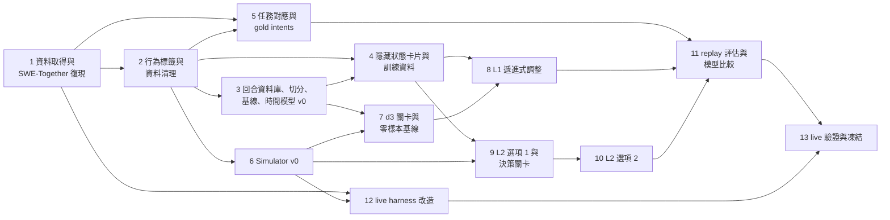

工作 12（live harness 改造）可與 8–11 並行。

建議先做「最小端到端版本」：約 20 個 checkpoint 與 3 個任務，不訓練，只用零樣本的 d3 與提示式 L2 跑通整條管線，再逐步加入微調與對抗式迭代。

---

## 6. 風險、未決事項與後續擴充

### 未決事項（需先確認）

| # | 項目 | 說明 | 相關章節 |
|---|---|---|---|
| 1 | d3 在 NVIDIA 上能否運作 | A100、H200 上官方未驗證；另有 few-shot 是否有效、微調是否可行（僅在升級到 S3 時需要；預設改走 chat 模型 LoRA） | §1.3、§3.1 |
| 2 | L2 選項 1 或選項 2（LoRA） | 依 §3.5 的決策關卡 | §3.5 |
| 3 | GPU | 有 A100 與 H200；A100 為 40 或 80 GB、各型號的張數與是否同機尚未確認 | 附錄 D |
| 4 | SWE-chat 各 agent 的 session 數量 | 未知；影響 leave-one-agent-out 是否可行 | §2.7 |
| 5 | SWE-Together 任務與 SWE-chat session 的對應 | 尚未驗證 | §2.8 |
| 6 | SWE-Together 的整合細節 | simulator 介面已讀（§1.4）；仍待確認：訊息如何由 harness 注入 agent（呼叫端 `UserEnabledClaudeCode` 不在該檔案內）、模型呼叫是否可指向自己的端點（走 LiteLLM，需實測） | §4.1 |
| 7 | opencode 的 hook | 是否提供寫入前或權限請求的 hook | §4.1 |
| 8 | 打斷所需的 harness 能力 | harness 能否在 agent 工作中注入訊息與取消 agent，尚未驗證；`queue_operation` 的欄位與硬打斷標記需在資料中確認 | §1.8 |
| 9 | 行為標籤雜訊 | 資料集中由 LLM 產生的標籤未經驗證，限制後續所有比較的上限；simulator 的標籤是自我宣告 | §2.2 |
| 10 | 資料取得 | 資料集需登入並接受存取條件；我方沙盒不一定能直接下載 | §2.1 |

### 風險

| 風險 | 說明 | 對策 |
|---|---|---|
| 隱私與記憶 | 示例庫會把真實訊息放進提示；若進行微調，模型還有記憶風險 | 匿名化、去重與授權確認 |
| 卡片的事後偏誤 | 隱藏狀態卡片是事後重建，訓練與測試的卡片分布不同，可能高估「照卡片做」的能力 | 有卡片與只有歷史的消融；結論註明卡片條件（§2.4） |
| 對抗式訓練 | 若採用選項 2b，它不穩定，且判別器擬真不等於行為正確 | 獨立判別器、硬性約束與多項指標並列（§3.5） |
| 族群代表性 | SWE-chat 來自公開 GitHub 倉庫的開源開發者，「與真人相似」只能宣稱與這個族群相似 | 在結論中明確限定族群 |
| agent 不一致 | 真人使用的 agent 與評估時的 agent 不同 | 以回合類型分層與 leave-one-agent-out 處理 |
| 缺少真實資料的事件 | 沒有計畫審核與權限的真實資料，C 與 R 的對應部分只能靠後續 pilot | 標為「無校準資料」 |

### 後續擴充

| 擴充 | 內容 |
|---|---|
| **打斷** | 先用 `queue_operation` 量測真人在 agent 忙碌時打字的頻率與時機，再加入 `user_interrupt` 事件；路徑與預留見 §1.8 |
| 計畫審核與權限事件 | 加入 `plan_submitted`、`permission_request` 阻塞點；回應用既有動作，AgentAdapter 加 `respond()` |
| 人類 pilot | 校準 review 決策、檢索與審查的 active time、R 的證據敏感度（RQ3、RQ4）；也可用 pilot 資料為判別器與 L1 增加真人資料 |
| K、B、P、A | K 的完整標註，以及 B、P、A 的 authored fixture 合規測試 |
| 工具權限 | 唯讀 inspect（T1）與執行檢查（T2） |
| 協同編輯 | simulator 修改檔案；需要新的任務切分（SWE-Together 排除了人類寫了大部分變更的 session）與新的評分方式（§1.4 規則 7） |
| 兩種運作模式 | 族群匹配模式（行為參數從真實分布抽樣）與受控模式（固定參數、可重複的壓力測試） |

---

### 擴充：Tagger 與 K/D/I/C 編碼

v1 暫緩。以下保留原設計，供日後使用；同時涵蓋重新標註的一致性檢查、K 揭露 recall 與洩漏率，以及 L1 的 D 觸發類型與目標修訂問題。

#### 編碼規格與 tagger

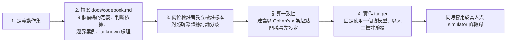

**動作集**（可依真實資料合併或精簡）：`no_op`、`answer`、`ask_clarification`、`new_requirement`、`redirect`、`approve`、`deny`、`inspect`、`accept`、`reject`、`request_evidence`、`defer`、`check_external`、`dont_know`。

**9 個編碼在本計畫的地位**　✓ 可　△ 部分　✗ 不可

| 編碼 | SWE-chat 可標註程度 | 首版處理 |
|---|---|---|
| D 揭露 | ✓ 可 | 完整做（條件行為） |
| I 意圖 | ✓ 可（需人工；資料已有粗粒度的 `prompt_intent`） | 完整做 |
| C 通道與時機 | △ 部分（chat；以 `first_write_position` 判斷寫入前後；計畫與權限無記錄） | 限制版 |
| R 審查與回應 | △ 部分（對 agent 完成宣稱的回應） | 限制版（粗略接受與糾正） |
| K 知識與存取 | △ 只能推論 | 子集，unknown 單獨列出 |
| B 信念 | ✗ 無法判斷對錯 | 僅 authored fixture |
| P 授權 | △ 部分 | 部分；合規測試為主 |
| A 注意力 | ✗ 不可 | 僅作為 simulator 狀態 |
| E 工作量 | △ 部分（時間戳記可近似回應延遲） | 時間模型校準 |


#### 診斷流程

不直接以 D、I、C、R 的比率為調整目標（避免循環論證），而是用它們在 dev 上找出是哪一層出問題：

| 編碼 | 症狀 | 最可能的層 | 該調什麼 |
|---|---|---|---|
| D | 針對性提問後揭露率偏低 | L1 | 該回合類型的動作校準；訓練資料平衡 |
| D | 動作對了但事實缺漏或太籠統 | 策略表或 L2 | 釋放規則；L2 的必含事實約束與訓練資料 |
| D | 揭露過多或洩漏 | L2 | 約束獎勵與洩漏過濾 |
| I | 修訂太少或太多 | L1 | new_requirement、redirect 的機率 |
| I | 修訂內容不像 | 任務設定 | 修改 fixture 或卡片，不是統計調整 |
| C | 介入時機偏晚 | checkpoint 設計 | 事件類型與詢問點 |
| R | 太容易接受 | L1 | 「agent 宣稱完成」回合類型的校準 |
| R | 對證據不敏感 | 資料限制 | 不在 SWE-chat 調整，留到 pilot |

唯一例外：產生它們的**條件機率**（例如「被針對性提問後揭露的機率」）可以在 train／dev 上直接擬合，因為它本身是條件行為參數，不是聚合比率。


## 附錄 A：設定檔範例

```yaml
experiment: replay_l1_s2_l2_opt1_v0
data: {checkpoints: data/processed/checkpoints_v1.parquet, split: dev}   # test 需 --final
simulator:
  visibility_profile: SWT            # SWT（預設，與 SWE-Together 一致）| P0–P3
  tools: [none]                      # none | inspect（僅 live）
  consult_on: [turn_end]             # 預留 tool_boundary（§1.8）
  l1:
    endpoint: http://localhost:8000/v1/systemone
    model: vllm-sr/d3-mini
    revision: <commit-hash>          # 必須固定
    stage: S2                        # S0 | S1 | S2 | S3
    questions: [behaviour, disclose_fact]
    fewshot: {bank: models/fewshot/l1_bank_<version>, k: <在 dev 上選>}   # S1
    calibration: models/calib/d3-mini_<version>.json                      # S2
  l2:
    option: 1                        # 1 | 2a | 2b
    model: <local-model-name>
    api_base: http://localhost:8001/v1
    length_model: models/stats/length_<version>.json
    fewshot: {bank: models/fewshot/l2_bank_<version>, k: <在 dev 上選>}
    adapter: null                    # 選項 2 才填（LoRA 權重）
evaluation: {discriminator: disc/eval_<version>}   # 必做，與訓練或重排序用判別器分開（§3.5）
seed: 0
```

## 附錄 B：DecisionClient 請求示意

依官方 recipe 頁的格式（`criteria`、`noul`）。`examples` 放在 state 內，僅在 few-shot 階段（S1）使用；官方沒有記載這樣是否有效。回傳為每個問題的選擇、各選項機率與 `confidence`，欄位名稱以實測為準；請求限制見 §1.3。

```json
{
  "model": "vllm-sr/d3-mini",
  "state": {"agent_turn_type": "asks_question", "agent_turn_summary": "...", "recent_user_messages": ["..."],
            "facts": [{"id": "F2", "status": "undisclosed", "holder": "privately_retrievable"}],
            "authority": {"may_approve": ["read"], "may_deny": ["delete"]}, "examples": []},
  "questions": {
    "behaviour": {"type": "choice", "instructions": "使用者此刻最可能做什麼？",
               "criteria": {"no_op": "不說話", "non_pushback": "發訊息但不反駁", "correction": "糾正 agent", "failure_report": "回報失敗", "rejection": "拒絕成果"}},
    "disclose_F2": {"type": "noul", "instructions": "使用者此刻會揭露 F2 嗎？"}
  }
}
```

## 附錄 C：資料來源

- SWE-Together（arXiv 2606.29957）：https://arxiv.org/pdf/2606.29957 ；程式碼：https://github.com/Togetherbench/SWE-Together
- Measuring and Mitigating the Distributional Gap Between Real and Simulated User Behaviors（arXiv 2605.07847）：https://arxiv.org/pdf/2605.07847
- SWE-chat（arXiv 2604.20779）：https://huggingface.co/datasets/SALT-NLP/SWE-chat
- vLLM Semantic Router Decision 3.0（d3）：https://huggingface.co/vllm-sr/d3 ；https://recipes.vllm.ai/vllm-sr/d3
- ModernBERT or DeBERTaV3?（arXiv 2504.08716，編碼器比較）：https://arxiv.org/abs/2504.08716
- Claude Code hooks 文件：https://code.claude.com/docs/en/hooks.md
- Claude Code 訊息排隊與打斷的行為差異（GitHub issues #36326、#52509、#67191）：https://github.com/anthropics/claude-code/issues
- RAID（arXiv 2405.07940，偵測器的穩健性基準）：https://arxiv.org/abs/2405.07940
- Binoculars（arXiv 2401.12070，零樣本機器文字偵測）：https://arxiv.org/abs/2401.12070
- Can We Trust LLM Detectors?（arXiv 2601.15301，領域轉移下的偵測器）：https://arxiv.org/abs/2601.15301
- Attacking Only Half the Data（arXiv 2610.18151，短文本的誤判）：https://arxiv.org/abs/2610.18151
- SimulatorArena（EMNLP 2025）：https://aclanthology.org/anthology-files/pdf/emnlp/2025.emnlp-main.1786.pdf
- MirrorBench（arXiv 2601.08118，使用者代理的擬真度基準）：https://arxiv.org/abs/2601.08118

---

## 附錄 D：GPU 記憶體估算（摘要）

**前提**：有 A100（40 或 80 GB，尚未確認）與 H200（141 GB）；張數與是否同機未知，以下以**單張**估算。vLLM 預設保留 92% 顯存（約 A100 40 GB 37 GiB、A100 80 GB 74 GiB、H200 129 GiB）。權重與 KV cache 為公式；d3 27B 的峰值為官方實測；其餘服務開銷與訓練需求為外推或經驗法則，需實測。d3 在 NVIDIA 上未經官方驗證，A100 沒有原生 FP8。

**推論（預留顯存，GiB）**

| 服務 | 預留估計 | 可用的卡 |
|---|---|---|
| d3-lite／nano／mini／flash | 約 8／12／17／26 | 三種卡皆可 |
| d3 27B | 62–65（官方實測） | H200；A100 80 GB 勉強（整張卡只能給它） |
| L2 約 8B | BF16 約 25；INT4 約 14 | 三種卡皆可 |
| L2 約 30B | BF16 約 71；INT4 約 30 | BF16 要 H200；INT4 可用 A100 80 GB |

同卡組合：d3-mini／flash ＋ L2 8B 約 42–51 GiB，需 A100 80 GB 以上；d3 27B ＋ L2 8B 約 90 GiB 或 d3 27B ＋ L2 30B INT4 約 95 GiB，需 H200；d3 27B ＋ L2 30B BF16 約 136 GiB，單張放不下。

**訓練（經驗法則，範圍很寬）**

| 工作 | 估計（GiB） | 需要的卡 |
|---|---|---|
| 判別器（0.1–0.5B 編碼器，或 1–2B ＋ LoRA） | 4–12 | 皆可 |
| L2 8B QLoRA／LoRA（BF16） | 12–20／25–40 | QLoRA 皆可；LoRA 建議 A100 80 GB 以上 |
| L2 30B QLoRA／LoRA（BF16） | 30–40／76–96 | QLoRA 建議 A100 80 GB 以上；LoRA 要 H200 |
| L2 選項 2b：方式 A／B／C（8B） | 35–55／35–55／50–90 | A／B 要 A100 80 GB 以上；C 要 H200 |
| L1 d3 LoRA（mini／flash／27B，僅在 d3 微調可行時） | 19–29／28–41／69–89 | 27B 要 H200 |

**d3 計算量**：prefix caching 關閉，每個問題一次完整的 forward pass，預填 tokens 總量 ≈ checkpoint 數 × 每個 checkpoint 的問題數 × 提示長度（例如 1 萬 × 4 × 4,000 ＝ 1.6 億 tokens）。NVIDIA 上的吞吐量未知，需實測；加入回合內詢問點（§1.8）會使詢問次數成倍增加，需靠閘門控制。

**建議配置（待 GPU 張數與型號確認）**：H200 做 27B 級實驗、L2 30B LoRA、2b 的強化學習；A100 80 GB 做 replay 評估服務（d3-mini／flash ＋ L2 8B）、8B LoRA／QLoRA、判別器、2b 方式 A／B；A100 40 GB 做單一小服務、QLoRA、判別器。兩張以上時，一張做服務、一張做訓練，避免搶記憶體。

---

## 附錄 E：指標公式（Intent Coverage 與分布差距）

參考實作 `metrics_ref.py` 另附檔（已用本附錄的兩個算例驗證：Intent Coverage 得 0.86；KL、JS、TV 得 0.1046、0.0915、0.0242、0.20）。

### E.0 與原論文的對照

本計畫的公式以兩篇論文為基礎，但有幾處是論文沒有規定、由本計畫補上的設計選擇，這裡逐項標明。

| 項目 | 原論文 | 本計畫 |
|---|---|---|
| **Intent Coverage：組合公式** | SWE-Together §2.3.2：IntentCoverage = round(0.70·Irecall + 0.30·Iprecision, 2) | 沿用此組合與權重 |
| recall | 稱為 weighted intent recall；權重如何設定，在我讀到的內容中沒有說明 | 預設等權（ω = 1），保留加權介面；權重待對照其評分腳本 |
| precision | 稱為 scope precision（simulator 的引導是否停在原使用者的範圍內） | 定義為「落在某個 gold intent 內的非 no_op 訊息比例」，可能與原定義不同，待對照其評分腳本 |
| matcher | 未說明由 LLM judge、人工或規則完成 | 固定的強模型，並以人工標籤抽樣驗證 |
| 一對一或多對多 | 未說明 | 主要報告一對一，同時報告多對多 |
| 位置視窗 | 未規定 | **本計畫新增**（單位：agent 回合），事先登記 |
| 聚合 | 逐個 replay trial 計分；跨重複與跨任務如何平均未明說 | trial → 任務（k 次重複平均）→ 跨任務等權平均 |
| **分布差距：分布的對象** | Mehri et al.：LLM 為每段對話寫行為描述，經 embedding（Qwen3-Embedding-8B，截斷為 1024 維）、PCA、k-means（k = 500）分群；P、Q 是真人與 simulator 在各群的比例 | 離散的行為標籤，在每個 agent 回合類型內計算；embedding 分群版可作為訊息層級的補充（公式相同） |
| 散度 | forward KL、backward KL、JS；沒有使用 TV 或 Wasserstein | 同樣三種，另加 TV（0–1 的直觀尺度） |
| 平滑 | Laplace 平滑，α = 1/k，套用於所有 KL 類指標 | α = 1/\|A\|（總偽計數為 1），並做 α 的敏感度檢查 |
| 跨條件聚合 | 各資料集分別報告，沒有跨任務的彙總分數 | 先在回合類型內計算，再以固定權重加總 |
| 信賴區間 | 沒有報告 CI、bootstrap 或顯著性檢定 | 開發者層級 bootstrap |
| 下界 | 每段真實對話配上留出的 WildChat 子集中目標相似的對話 | 真實資料依開發者對半切，重複多次 |

說明：Mehri et al. 的頁面我只讀到前約 100,000 字元（全文約 144,789 字元），附錄可能還有更多細節；SWE-Together 的評分腳本我也還沒讀。這兩項列為待辦。

### E.1 Intent Coverage（面向 A）

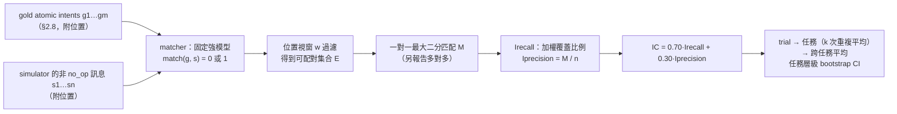

**符號**

| 符號 | 意義 |
|---|---|
| t、r | 任務、第 r 次重複 |
| G = {g₁…g_m} | 任務 t 的 gold atomic intents（§2.8），位置 pos(gᵢ) 以 agent 回合數計 |
| S = {s₁…s_n} | simulator 在該次重複中的非 no_op 訊息，位置 pos(sⱼ) |
| match(gᵢ, sⱼ) ∈ {0, 1} | matcher 的判定 |
| w | 位置視窗（回合數），事先登記 |
| ωᵢ | gold intent 的權重，預設 1 |

**公式**

```
可配對集合    E = { (i, j) : match(gᵢ, sⱼ) = 1  且  |pos(sⱼ) − pos(gᵢ)| ≤ w }

一對一（主要）
  M          = E 上最大二分匹配的大小
  Irecall    = Σ_{i 被匹配} ωᵢ / Σ_i ωᵢ
  Iprecision = M / n

多對多（寬鬆，同時報告）
  Irecall    = (1/m) · Σ_i 1[ ∃j : (i, j) ∈ E ]
  Iprecision = (1/n) · Σ_j 1[ ∃i : (i, j) ∈ E ]

IC = 0.70 · Irecall + 0.30 · Iprecision
F1 = 2 · Irecall · Iprecision / (Irecall + Iprecision)
```

一對一與多對多的差別：多對多下，simulator 把同一個意圖重複講兩次，兩則都算「精確」；一對一只算一則，重複發言會拉低 precision。

**邊界情形（本計畫的設定）**：m = 0 的任務不納入；n = 0（simulator 全程沉默）時 Iprecision 記為 0，並另外報告沉默的任務比例。

**聚合**

```
IC_任務 = (1/K) · Σ_r IC_{t,r}                  （K 次重複）
IC      = (1/T) · Σ_t IC_任務                    （任務等權，T 為該切分的任務數）
信賴區間：對任務重抽 bootstrap（B = 1000），取 2.5% 到 97.5% 百分位
```

**相關量（本計畫的定義）**

```
Action-type recall / precision：同上，match 改為「動作類型相同」（仍套位置視窗）
時機對齊      Δ = (1/M) · Σ_{(i,j) ∈ 配對} | pos(sⱼ) − pos(gᵢ) |          （回合）
K 揭露 recall = 被揭露的私有事實數 / 應揭露的私有事實數
K 洩漏率      = 在釋放條件成立前就被揭露的事實數 / 被揭露的事實總數
```

**算例**：m = 5、n = 4、一對一配對 M = 4：Irecall = 4/5 = 0.80，Iprecision = 4/4 = 1.00，IC = 0.70 × 0.80 + 0.30 × 1.00 = 0.86，F1 ≈ 0.89。

### E.2 分布差距（面向 B）

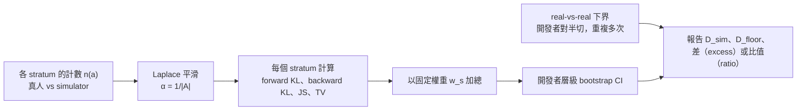

**符號**

| 符號 | 意義 |
|---|---|
| A | 類別集合（行為標籤集） |
| s ∈ 𝒮 | agent 回合類型（§2.6）；每個類型一個 stratum |
| nᴿₛ(a)、nˢₛ(a) | stratum s 內，真人與 simulator 在類別 a 的次數；Nᴿₛ = Σₐ nᴿₛ(a) |

**公式（自然對數，單位 nats）**

```
平滑       Pₛ(a) = ( nᴿₛ(a) + α ) / ( Nᴿₛ + α·|A| ) ，Qₛ(a) 對 simulator 同理，α = 1/|A|

Forward KL   D_F,s = KL(Pₛ ‖ Qₛ) = Σₐ Pₛ(a) · ln( Pₛ(a) / Qₛ(a) )
Backward KL  D_B,s = KL(Qₛ ‖ Pₛ) = Σₐ Qₛ(a) · ln( Qₛ(a) / Pₛ(a) )
JS           D_J,s = ½·KL(Pₛ ‖ Mₛ) + ½·KL(Qₛ ‖ Mₛ) ，Mₛ = (Pₛ + Qₛ) / 2        （範圍 0 到 ln 2）
TV           D_T,s = ½ · Σₐ | Pₛ(a) − Qₛ(a) |                                    （範圍 0 到 1）

跨 stratum 聚合  D = Σₛ wₛ · Dₛ ，  wₛ = Nᴿₛ / Σₛ' Nᴿₛ'
  權重取自 test 集中各回合類型的比例，事先固定，不隨 simulator 改變
```

**解讀**

| 指標 | 偏高代表什麼 | 型態 |
|---|---|---|
| Forward KL（KL(真人 ‖ simulator)） | simulator 漏掉真人會做的行為 | recall 型（Mehri et al. 的解讀） |
| Backward KL（KL(simulator ‖ 真人)） | simulator 做了真人很少做的行為，例如多話、過度揭露 | precision 型（同上） |
| JS | 兩種失敗都會推高 | 對稱 |
| TV | 需要搬動的機率質量 | 直觀、有上界 |

**下界與超額量**

```
D_floor：把真實資料依開發者隨機對半（H₁、H₂），P 來自 H₁、Q 來自 H₂，
         用同樣的公式與權重計算；重複 R 次（例如 R = 100）取平均
報告：D_sim、D_floor，以及  excess = D_sim − D_floor  （或  ratio = D_sim / D_floor ）
```

比較 D_sim 與 D_floor 時，兩邊的樣本數要相當（對較大的一側子抽樣），因為 plug-in 的 KL 估計量有正的有限樣本偏差，一階近似約為 (|A| − 1) / (2N)，樣本越少偏差越大。

**信賴區間**：以開發者為單位重抽（B = 1000）。replay 中 simulator 的輸出與真實 checkpoint 一一對應，所以隨開發者一起重抽；live 中對任務重抽。每次重抽都重新計算 D（含權重），取 2.5% 到 97.5% 百分位。

**每個 session 的比率分布（含離散程度）**

```
rᵤ(a) = session u 中動作為 a 的 checkpoint 數 / 該 session 的 checkpoint 數
比較 { rᵤᴿ(a) }ᵤ 與 { rᵤˢ(a) }ᵤ：
  W₁ = ∫ | F_R(x) − F_S(x) | dx              （Wasserstein-1；F 為經驗 CDF）
  KS = supₓ | F_R(x) − F_S(x) |
  離散程度比 = σ_S(a) / σ_R(a)                （σ 為各 session 比率的標準差；1 表示異質性相同）
```

**條件行為**

```
Δ_cond(x | c) = P_S(x | c) − P_R(x | c)
例：x = 揭露事實，c = agent 針對性提問；信賴區間做法同上
```

**算例**：A = {no_op, answer, other}，真人 P = (0.60, 0.30, 0.10)，simulator Q = (0.80, 0.15, 0.05)（未平滑）：Forward KL ≈ 0.105 nats，Backward KL ≈ 0.092 nats，JS ≈ 0.024 nats，TV = 0.20。simulator 偏愛沉默，並且低估 answer 與 other。

### E.3 待確認

| # | 項目 | 做法 |
|---|---|---|
| 1 | SWE-Together 的評分腳本 | 確認 matcher、一對一或多對多、位置視窗、recall 權重與 precision 的實際定義，必要時調整 §E.1 |
| 2 | Mehri et al. 的附錄 | 讀完全文，確認平滑、分群與下界的其他細節 |
| 3 | 事先登記 | 位置視窗 w、平滑係數 α、bootstrap 次數 B、下界的重複次數 R，在看到 test 結果之前登記 |
| 4 | K 揭露 recall 與洩漏率 | 本計畫自訂的定義，需與 K 編碼對齊（暫緩擴充） |
